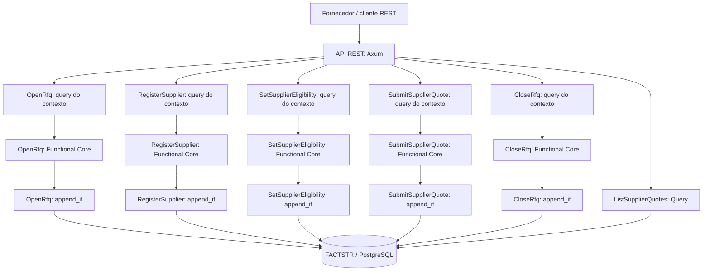

# Supplier RFQ — Domain Capabilities / RPU / CCC + Event Sourcing + FACTSTR

Implementação de referência em Rust de um pequeno fluxo de **Supply Chain / Request for Quotation (RFQ)**. Esta branch adiciona Event Sourcing com [FACTSTR](https://github.com/ricofritzsche/factstr) à implementação original relacional, preservada na branch `main` para estudo e comparação.

> **Escopo educacional:** não é uma solução de procurement pronta para produção. Não inclui autenticação/autorização, anexos de documentos, impostos, workflow de aprovação, seleção multicritério, idempotência HTTP ou uma projeção persistida para consultas de alto volume.

## Stack

- [Rust stable](https://www.rust-lang.org/tools/install)
- [Axum 0.8.9](https://docs.rs/axum/latest/axum/) para a API REST
- [FACTSTR 0.5.2](https://github.com/ricofritzsche/factstr) + [factstr-postgres 0.5.2](https://github.com/ricofritzsche/factstr/tree/main/factstr-postgres) para o Event Store e `append_if`
- [PostgreSQL 16](https://www.postgresql.org/docs/16/)
- [Testcontainers Modules 0.15.0](https://docs.rs/testcontainers-modules/latest/testcontainers_modules/) para testes de integração com PostgreSQL real

## Visão arquitetural



O diagrama descreve o princípio de composição. Na implementação, cada Domain Capability tem a sua própria RPU e a sua própria query de contexto; elas não compartilham uma decisão de negócio genérica.

## Nomenclatura (Rico Fritzsche)

- **Domain Capability:** uma coisa que o domínio pode fazer, um Command ou Query.
- **Request Processing Unit (RPU):** unidade que implementa o caminho completo do pedido até a resposta para uma capability.
- **Functional Core / Imperative Shell:** decisão pura sobre uma entrada e um contexto explícito; a shell faz consultas ao Event Store, serialização e I/O.
- **Application State:** fatos autorizados que representam o estado do domínio. Nesta branch, o registro autoritativo é o log append-only administrado por FACTSTR.
- **Command Context Consistency (CCC):** a decisão só pode ser registrada se o contexto de fatos em que ela se baseou continuar na versão esperada. É aplicado com `EventStore::append_if`.
- **FACTSTR:** contrato de Event Store para fatos append-only, consultas de contexto, append condicional e streams.

Referências: [Architecture Knowledge Base — conceitos](https://architecture.ricofritzsche.me/concepts/), [Request Processing Units](https://architecture.ricofritzsche.me/concepts/request-processing-units/), [Command Context Consistency](https://architecture.ricofritzsche.me/concepts/command-context-consistency/), [FACTSTR](https://github.com/ricofritzsche/factstr), [exemplo Tool Rental de Rico](https://github.com/ricofritzsche/factstr-tool-rental-example).

## Domain Capabilities implementadas

| Capability | Tipo | Endpoint | Fato produzido / resultado |
|---|---|---|---|
| `OpenRfq` | Command | `POST /api/rfqs` | `rfq_opened.v1` · `201` |
| `RegisterSupplier` | Command | `POST /api/suppliers` | `supplier_registered.v1` · `201` |
| `SetSupplierEligibility` | Command | `PUT /api/suppliers/{supplier_id}/eligibility` | `supplier_eligibility_changed.v1` · `200` |
| `SubmitSupplierQuote` | Command | `POST /api/rfqs/{rfq_id}/quotes` | `supplier_quote_submitted.v1` · `201` |
| `CloseRfq` | Command | `POST /api/rfqs/{rfq_id}/close` | `rfq_closed.v1` · `200` |
| `ListSupplierQuotes` | Query | `GET /api/rfqs/{rfq_id}/quotes` | View derivada dos fatos · `200` |
| Health | Infraestrutura | `GET /health` | `200` |

Os nomes dos fatos têm sufixo `.v1` para tornar explícita a versão do contrato de evento. Um evento já persistido não deve ser alterado; mudanças de contrato futuras precisam de uma estratégia explícita de versionamento/upcasting.

## Estratégia de Application State e Event Sourcing

Esta branch não mantém tabelas de negócio `rfqs`, `rfq_items`, `suppliers` ou `supplier_quotes`. As operações autoritativas são fatos no Event Store do FACTSTR. O próprio FACTSTR gerencia suas tabelas internas; a aplicação não deve escrevê-las diretamente.

Fatos centrais:

- `rfq_opened.v1`: abre a RFQ e carrega a lista imutável de itens, quantidades requeridas e moeda.
- `supplier_registered.v1`: registra a identidade do fornecedor e sua referência natural. A identidade e a referência não são alteradas nesta referência.
- `supplier_eligibility_changed.v1`: registra somente a mudança de status de elegibilidade; o status corrente é o último fato dessa capability para o fornecedor.
- `supplier_quote_submitted.v1`: registra a cotação aceita, linhas, preços em centavos, total, prazo e validade.
- `rfq_closed.v1`: registra o fechamento da RFQ.

`ListSupplierQuotes` lê os fatos relevantes e materializa a resposta em memória a cada chamada. É proposital para manter o exemplo pequeno e inspecionável; com alto volume, latência estrita ou grande histórico, introduza uma projeção persistida atualizada por `stream_to_durable` do FACTSTR e mantenha o cursor e a projeção na mesma fronteira de durabilidade.

## Como a RPU de SubmitSupplierQuote aplica CCC

1. Constrói uma `EventQuery` com os fatos que influenciam esta decisão:
   - `rfq_opened.v1` e `rfq_closed.v1` para a RFQ;
   - alterações de elegibilidade para o fornecedor em questão;
   - cotações anteriores somente para o par RFQ/fornecedor em questão.
2. Executa `query` e recebe os eventos do contexto e `current_context_version`.
3. Reconstrói o contexto mínimo, decide se a cotação pode ser aceita e calcula o total com inteiros (centavos), sem `f64`.
4. Executa `append_if` com a query original e a versão observada. Se o contexto mudou, FACTSTR devolve `ConditionalAppendConflict`; nada é acrescentado por aquela tentativa.
5. A RPU relê o contexto uma vez para transformar corridas comuns em uma rejeição de negócio atual (por exemplo, fornecedor duplicado ou RFQ fechada). Se continuar havendo conflito, devolve `command_context_changed`.

**O escopo da query de contexto é parte da regra de consistência.** Uma nova cotação de outro fornecedor não corresponde ao filtro de `supplier_quote_submitted.v1` deste comando, evitando que toda cotação na RFQ invalide desnecessariamente as outras. O fato de fechamento, por outro lado, é parte do contexto de toda submissão daquela RFQ e invalida uma decisão que ainda tentava usar o estado aberto.

`OpenRfq`, `RegisterSupplier`, `SetSupplierEligibility` e `CloseRfq` também usam `append_if` nas suas respectivas queries de contexto. `OpenRfq` protege `rfq_id` e referência da RFQ; `RegisterSupplier` protege `supplier_id` e referência do fornecedor. A referência do fornecedor é imutável nesta versão; o status é um fato separado. Isso substitui, nesta variante, parte das garantias que na abordagem relacional seriam expressas por constraints `UNIQUE`: a consulta de contexto precisa incluir cada chave de negócio que exige unicidade. `SetSupplierEligibility` inclui o fato de registro e o histórico de elegibilidade daquele ID no seu contexto. A Query não altera Application State.

## Testes e raciocínio da estratégia de concorrência

A suíte combina testes unitários, aceitação HTTP e provas de consistência sob cenários concorrentes:

1. **Testes unitários do Functional Core** (`decision.rs`): verificam cálculo, quantidade e rejeições com entradas/contextos construídos diretamente, sem rede ou Event Store.
2. **Testes de aceitação REST** (`tests/acceptance_api.rs`): iniciam PostgreSQL 16 descartável com Testcontainers, conectam FACTSTR ao banco real, sobem Axum em uma porta efêmera e chamam os endpoints via HTTP. Verificam o ciclo de abertura/registro/elegibilidade/submissão, pré-condições de elegibilidade, respostas, fatos persistidos, rejeições sem escrita e o cenário de fechamento concorrente.
3. **Prova determinística de CCC** (`ccc_two_independent_stores_from_same_snapshot_commit_exactly_one_quote_fact`): cria **duas instâncias independentes de `PostgresStore`**, carrega o mesmo contexto nas duas, prepara duas decisões, confirma por asserção que ambas viram a mesma versão e só então libera uma `Barrier` imediatamente antes do `append_if`. As duas escritas tentam gravar usando a mesma versão esperada. O teste exige um append bem-sucedido, um `ConditionalAppendConflict` e exatamente um fato de cotação persistido.
4. **CCC sem conflito falso entre contextos independentes** (`ccc_independent_supplier_contexts_commit_without_false_conflict`): prepara cotações para dois fornecedores diferentes na mesma RFQ e as comita com stores independentes. Ambas devem ser aceitas porque uma submissão para o fornecedor A não muda o contexto de elegibilidade nem a unicidade da cotação do fornecedor B.
5. **Consistência sob mudança de elegibilidade** (`ccc_supplier_eligibility_change_invalidates_a_prepared_quote`): prepara uma cotação enquanto o fornecedor está elegível, registra o bloqueio através de outro `PostgresStore` e prova que a cotação preparada contra o snapshot antigo não é gravada.
6. **Pré-condições do fornecedor** (`acceptance_requires_registration_and_eligibility_before_quote_submission`): fornecedor não registrado resulta em `404`; fornecedor registrado sem elegibilidade definida resulta em `409`; nenhum dos comandos rejeitados grava fato de cotação.
7. **Chaves naturais únicas** (`acceptance_rejects_duplicate_natural_references_without_appending_facts`): valida por HTTP que referências já usadas por RFQ ou fornecedor não são reutilizadas e que as tentativas rejeitadas não adicionam fatos.

A `Barrier` sozinha apenas sincroniza o início das tarefas; ela não garante que as duas operações tenham lido o mesmo snapshot. O teste determinístico evita essa ambiguidade ao preparar as duas decisões antes da barreira e verifica que ambas observaram a mesma versão de contexto antes de qualquer append. Não usa mutex de aplicação nem modifica o código/schema de produção. O PostgreSQL/FACTSTR real decide qual append ganha. Um teste adicional confirma que duas cotações simultâneas de fornecedores diferentes, cada uma com seu contexto de elegibilidade próprio, não geram conflito semântico falso.

O teste de concorrência HTTP é um teste de aceitação útil, mas não deve ser confundido com a prova de CCC: dependendo do escalonamento, a segunda requisição pode observar o fato criado pela primeira antes de preparar sua decisão. A prova direta `append_if` complementa o caminho HTTP exercitando dois clientes Event Store independentes.

### Comandos de teste

O Docker precisa estar ativo. Na raiz do projeto:

```bash
cargo fmt --all -- --check
cargo test --lib
cargo test --test acceptance_api
cargo test
cargo clippy --all-targets --all-features -- -D warnings
```

Para rodar apenas a prova determinística:

```bash
cargo test --test acceptance_api ccc_two_independent_stores_from_same_snapshot_commit_exactly_one_quote_fact -- --nocapture
```

Os testes criam containers de PostgreSQL descartáveis e não usam o banco do `docker-compose.yml`.

## Executar localmente

1. Suba o PostgreSQL:

   ```bash
   docker compose up -d postgres
   ```

2. Configure o ambiente:

   ```bash
   cp .env.example .env
   ```

   Ajuste `DATABASE_URL` se necessário. O banco-alvo precisa existir; `factstr-postgres` inicializa o schema do Event Store nele.

3. Inicie a API:

   ```bash
   cargo run
   ```

4. Em outro terminal, grave os fatos de demonstração (execute uma vez em um banco vazio). O script registra o fornecedor e então configura a elegibilidade como comandos distintos:

   ```bash
   ./scripts/seed_demo.sh
   ```

5. Envie uma cotação:

   ```bash
   curl -i -X POST \
     http://127.0.0.1:3000/api/rfqs/11111111-1111-4111-8111-111111111111/quotes \
     -H 'Content-Type: application/json' \
     -d '{
       "supplier_id":"22222222-2222-4222-8222-222222222222",
       "currency":"BRL",
       "delivery_days":7,
       "valid_until":"2099-12-31",
       "items":[
         {"rfq_item_id":"44444444-4444-4444-8444-444444444441","quantity":10,"unit_price_cents":1250},
         {"rfq_item_id":"44444444-4444-4444-8444-444444444442","quantity":5,"unit_price_cents":3000}
       ]
     }'
   ```

O total esperado é `27500` centavos (R$ 275,00). Uma segunda submissão para a mesma RFQ/fornecedor retorna `409` e não registra outro fato de cotação.

Consulte as cotações:

```bash
curl -sS http://127.0.0.1:3000/api/rfqs/11111111-1111-4111-8111-111111111111/quotes
```

Contrato OpenAPI: [`docs/openapi.yaml`](docs/openapi.yaml). A decisão arquitetural, escopos CCC e limites do backend estão em [`docs/architecture-event-sourcing-factstr.md`](docs/architecture-event-sourcing-factstr.md).

## Comparar com a implementação relacional

- `main`: implementação relacional original, com tabelas de Application State, locks/constraints e testes concorrentes da API.
- `event-sourcing-factstr`: esta variante; FACTSTR é a fonte de verdade, e CCC ocorre via `append_if` de uma query de fatos. Registro de fornecedor e definição de elegibilidade são capabilities separadas.

Compare as implementações com `git diff main...event-sourcing-factstr` ou alterne de branch. São duas estratégias para o mesmo recorte de domínio, não uma migração que remove a implementação original.

## Limites conhecidos e trade-offs

- A consulta refaz a leitura/fold dos fatos a cada pedido; ainda não existe projeção materializada nem snapshots.
- O Event Store tem sequência global. O isolamento lógico do CCC depende de filtros/predicados corretos; filtros largos demais geram conflitos desnecessários, e filtros estreitos demais podem permitir decisões inválidas. A identidade do fornecedor é um fato separado e sua referência natural não pode ser renomeada neste exemplo; caso o domínio precise de renomeação, represente-a com uma capability/fato específico e defina a semântica de unicidade para o histórico.
- **Trade-off da implementação PostgreSQL atual do FACTSTR:** a versão `factstr-postgres 0.5.2` serializa appends obtendo `LOCK TABLE events, append_batches IN EXCLUSIVE MODE` e, em seguida, revalida o contexto filtrado. Portanto, o `append_if` oferece a garantia CCC correta, mas append throughput pode ser limitado pela serialização global do backend; o filtro de contexto evita conflitos semânticos entre comandos independentes, mas não elimina esse gargalo físico. Ver [implementação `append_if_with_pool` e `lock_events_tables`](https://github.com/ricofritzsche/factstr/blob/main/factstr-postgres/src/postgres_store.rs). Reavalie esse comportamento conforme a versão usada e meça throughput/latência antes de assumir alta concorrência.
- Todos os contratos de evento são JSON versionado por nome. Evoluções futuras precisam de uma política de compatibilidade e replay.
- Não há idempotency key para repetições de rede. A regra “uma cotação por RFQ/fornecedor” é protegida pela query de contexto e `append_if`, não por uma tabela unique da aplicação.
- O exemplo usa estado atual por replay em memória; não deve ser tratado como arquitetura de alta escala sem medições e projeções.
