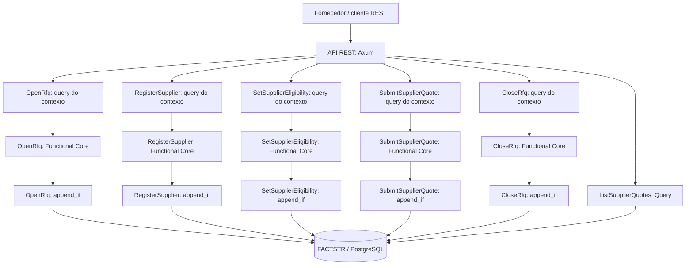
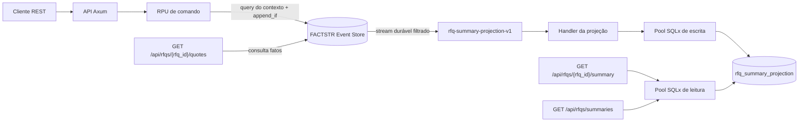
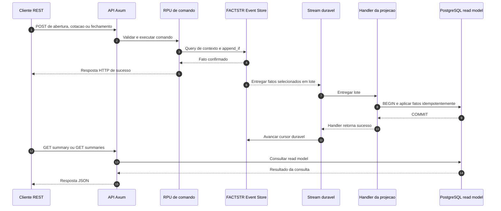

# Supplier RFQ — Domain Capabilities / RPU / CCC + Event Sourcing + FACTSTR

Implementação de referência em Rust de um pequeno fluxo de **Supply Chain / Request for Quotation (RFQ)**. Esta branch adiciona Event Sourcing com [FACTSTR](https://github.com/ricofritzsche/factstr) à implementação original relacional, preservada na branch `main` para estudo e comparação.

> **Escopo educacional:** não é uma solução de procurement pronta para produção. A lista de pendências operacionais está em [Preparação para operação real](#pendências-para-operação-real). A projeção persistida é específica para resumos de RFQs, não é uma solução genérica de analytics e ainda não foi validada por benchmarks de alto volume.

## Guia de arquitetura

Leia [`docs/design-approach.md`](docs/design-approach.md) para a explicação dos conceitos, diagramas Mermaid dos fluxos RPU/CCC/projeção e checklist para evoluir capabilities. A decisão técnica específica desta variante está em [`docs/architecture-event-sourcing-factstr.md`](docs/architecture-event-sourcing-factstr.md).

## Pendências para operação real

Este repositório continua sendo uma referência educacional. Os itens abaixo permanecem explicitamente **pendentes** e precisam de critérios de aceite antes de qualquer uso real.

| Estado | Área | Pendência / critério mínimo de saída |
|---|---|---|
| [ ] | Segurança | Autenticação, autorização por capability/fornecedor, gestão de segredos, rate limiting e limites de payload. Testes negativos de acesso indevido. |
| [~] | Idempotência HTTP | `Idempotency-Key`, fingerprint, replay e bloqueio conservador implementados; ainda exige reconciliação operacional, observabilidade e testes de recuperação antes de produção. |
| [~] | Application State Provider | Porta tipada e adaptador FACTSTR implementados nesta mudança; exigir suíte de contrato/CCC verde e revisão do diff antes do merge. |
| [ ] | Contratos de API | Evoluir OpenAPI para cobrir todos os schemas de resposta, erros, códigos HTTP e política de versionamento; validar compatibilidade automática. |
| [ ] | Erros e dados sensíveis | Respostas 5xx genéricas e estáveis; detalhes técnicos apenas nos logs; correlação de requisição sem vazar dados sensíveis. |
| [ ] | Observabilidade | Métricas para latência/erros de comandos, CCC conflicts, atraso da projeção, falhas de handler, cursor e startup; alertas e dashboards. |
| [ ] | Disponibilidade | Separar liveness/readiness, definir shutdown gracioso, timeouts, limites dos pools, política de retry/backoff e comportamento em indisponibilidade do PostgreSQL. |
| [ ] | Projeções | Substituir instruções manuais que apagam cursor/tabelas internas por procedimento de rebuild versionado, testado e seguro; validar replay, retenção e recuperação. |
| [ ] | Dados e recuperação | Política de backup/restore, RPO/RTO, testes periódicos de recuperação, migrações compatíveis e estratégia de versionamento/upcasting dos fatos. |
| [ ] | Desempenho | Benchmarks reproduzíveis de throughput/latência e carga com históricos grandes; testar custo de `ListSupplierQuotes`, concorrência de append e catch-up da projeção. Definir limites e SLOs. |
| [ ] | Escopo de procurement | Modelar e validar anexos, impostos, aprovação, seleção multicritério, retenção/auditoria e regras fiscais antes de assumir cobertura funcional de produto. |
| [ ] | Operação | Runbooks de incidente, deploy/rollback, migração, projeção atrasada/falha, rotação de segredos e responsabilidades operacionais. |

Não marque um item como concluído somente porque a aplicação compila. Cada pendência deve ter uma decisão registrada, testes adequados e evidência operacional verificável.

## Stack

- [Rust stable](https://www.rust-lang.org/tools/install)
- [Axum 0.8.9](https://docs.rs/axum/latest/axum/) para a API REST
- [FACTSTR 0.5.2](https://github.com/ricofritzsche/factstr) + [factstr-postgres 0.5.2](https://github.com/ricofritzsche/factstr/tree/main/factstr-postgres) para o Event Store e `append_if`
- [PostgreSQL 16](https://www.postgresql.org/docs/16/)
- [Testcontainers Modules 0.15.0](https://docs.rs/testcontainers-modules/latest/testcontainers_modules/) para testes de integração com PostgreSQL real

## Visão arquitetural



O diagrama descreve o princípio de composição. Na implementação, cada Domain Capability tem a sua própria RPU e a sua própria query de contexto; elas não compartilham uma decisão de negócio genérica.

## Nomenclatura (Rico Fritzsche)

- **Domain Capability:** uma coisa que o domínio pode fazer, um Command ou Query.
- **Request Processing Unit (RPU):** unidade que implementa o caminho completo do pedido até a resposta para uma capability.
- **Functional Core / Imperative Shell:** decisão pura sobre uma entrada e um contexto explícito; a shell faz consultas ao Event Store, serialização e I/O.
- **Application State:** fatos autorizados que representam o estado do domínio. Nesta branch, o registro autoritativo é o log append-only administrado por FACTSTR.
- **Command Context Consistency (CCC):** a decisão só pode ser registrada se o contexto de fatos em que ela se baseou continuar na versão esperada. É aplicado com `EventStore::append_if`.
- **FACTSTR:** contrato de Event Store para fatos append-only, consultas de contexto, append condicional e streams.

Referências: [Architecture Knowledge Base — conceitos](https://architecture.ricofritzsche.me/concepts/), [Request Processing Units](https://architecture.ricofritzsche.me/concepts/request-processing-units/), [Command Context Consistency](https://architecture.ricofritzsche.me/concepts/command-context-consistency/), [FACTSTR](https://github.com/ricofritzsche/factstr), [exemplo Tool Rental de Rico](https://github.com/ricofritzsche/factstr-tool-rental-example).

## Application State Provider e confiabilidade HTTP

`ApplicationStateProvider` é a porta da aplicação para ler fatos tipados e registrar consequências contra uma versão de contexto opaca. `FactstrApplicationStateProvider` concentra a conversão para `EventQuery`/`EventFilter`/`EventRecord`/`NewEvent` e os conflitos CCC. `CommandRpus`/`QueryRpus` consomem a porta; handlers não recebem o Store bruto. A projeção de resumos permanece um read model SQLx independente.

O ledger HTTP usa um pool limitado dedicado, estado `in_progress`/`completed`/`unknown` e controles de inicialização/checksum próprios. A migration original em `migrations/` permanece preservada para compatibilidade com bancos que já a registraram no migrator SQLx; a cópia em `migrations_idempotency/` é idempotente e tem histórico/checksum próprio. A separação de pool não cria transação distribuída entre FACTSTR e ledger.

Leia [`ADR-0026`](docs/architecture/adr/0026-application-state-provider.md), [`ADR-0027`](docs/architecture/adr/0027-http-idempotency-failure-testing.md), [`guia de testes ASP`](docs/testing/application-state-provider.md), [`testes de idempotência`](docs/testing/http-idempotency-testing.md) e o [`runbook`](docs/operations/http-idempotency.md). Antes de commit/push, execute `bash scripts/run-all.sh` ou as etapas listadas em `docs/PLANO-E-CRITERIOS-DE-ACEITE.md`; commit/push exige `PUSH_TO_GITHUB=YES` explícito.

## Domain Capabilities implementadas

| Capability | Tipo | Endpoint | Fato produzido / resultado |
|---|---|---|---|
| `OpenRfq` | Command | `POST /api/rfqs` | `rfq_opened.v1` · `201` |
| `RegisterSupplier` | Command | `POST /api/suppliers` | `supplier_registered.v1` · `201` |
| `SetSupplierEligibility` | Command | `PUT /api/suppliers/{supplier_id}/eligibility` | `supplier_eligibility_changed.v1` · `200` |
| `SubmitSupplierQuote` | Command | `POST /api/rfqs/{rfq_id}/quotes` | `supplier_quote_submitted.v1` · `201` |
| `CloseRfq` | Command | `POST /api/rfqs/{rfq_id}/close` | `rfq_closed.v1` · `200` |
| `ListSupplierQuotes` | Query | `GET /api/rfqs/{rfq_id}/quotes` | View derivada dos fatos · `200` |
| `GetRfqSummary` | Query | `GET /api/rfqs/{rfq_id}/summary` | Read model `rfq_summary_projection` · `200` / `404` enquanto ausente |
| `ListRfqSummaries` | Query | `GET /api/rfqs/summaries` | Read model filtrado e paginado · `200` / `400` para parâmetros inválidos |
| Health | Infraestrutura | `GET /health` | `200` |

Os nomes dos fatos têm sufixo `.v1` para tornar explícita a versão do contrato de evento. Um evento já persistido não deve ser alterado; mudanças de contrato futuras precisam de uma estratégia explícita de versionamento/upcasting.

## Estratégia de Application State e Event Sourcing

Esta branch não mantém tabelas de negócio `rfqs`, `rfq_items`, `suppliers` ou `supplier_quotes`. As operações autoritativas são fatos no Event Store do FACTSTR. O próprio FACTSTR gerencia suas tabelas internas; a aplicação não deve escrevê-las diretamente.

Fatos centrais:

- `rfq_opened.v1`: abre a RFQ e carrega a lista imutável de itens, quantidades requeridas e moeda.
- `supplier_registered.v1`: registra a identidade do fornecedor e sua referência natural. A identidade e a referência não são alteradas nesta referência.
- `supplier_eligibility_changed.v1`: registra somente a mudança de status de elegibilidade; o status corrente é o último fato dessa capability para o fornecedor.
- `supplier_quote_submitted.v1`: registra a cotação aceita, linhas, preços em centavos, total, prazo e validade.
- `rfq_closed.v1`: registra o fechamento da RFQ.

`ListSupplierQuotes` continua mostrando a consulta direta ao log para manter explícita a semântica Event Sourcing. Para consultas de resumo, esta branch também implementa a projeção persistida `rfq_summary_projection`, atualizada pelo stream durável `rfq-summary-projection-v1` do FACTSTR. A projeção é um read model derivado, não uma segunda fonte de verdade.

### Projeção de leitura `rfq_summary_projection`

A migration da aplicação está em [`migrations/202610240001_rfq_summary_projection.sql`](migrations/202610240001_rfq_summary_projection.sql). Ao iniciar, a aplicação executa a migration e registra `stream_to_durable` para `rfq_opened.v1`, `rfq_closed.v1` e `supplier_quote_submitted.v1`. O FACTSTR reprocessa o histórico não consumido e depois entrega novos fatos ao handler da projeção.

A projeção materializa, por RFQ, referência, moeda, status (`open`/`closed`), datas de abertura/fechamento, quantidade de itens, quantidade de cotações, menor total cotado em centavos, fornecedor da menor cotação, última sequência de evento aplicada e timestamp da projeção.

#### Como os fatos são consumidos e transformados

O stream durável utiliza o identificador estável `rfq-summary-projection-v1` e seleciona três tipos de fatos. O filtro é intencional: esta projeção representa o ciclo de vida da RFQ e os indicadores de cotação; não precisa materializar a identidade nem a elegibilidade dos fornecedores.

| Fato versionado | Efeito em `rfq_summary_projection` |
|---|---|
| `rfq_opened.v1` | Cria o resumo da RFQ com referência, moeda, data de abertura, quantidade de itens, status `open`, `quote_count = 0` e menor cotação nula. |
| `supplier_quote_submitted.v1` | Incrementa `quote_count` quando uma sequência nova é aplicada. Atualiza `lowest_quote_amount_cents` e `lowest_quote_supplier_id` quando a cotação tem total menor que o atual. O cálculo usa centavos inteiros, sem ponto flutuante. Em empate, o fornecedor da menor cotação já registrada permanece. |
| `rfq_closed.v1` | Altera o status para `closed`, grava `closed_at` e atualiza a sequência aplicada. Se a RFQ ainda não tiver linha na projeção, o handler falha em vez de criar um resumo incompleto. |

Os fatos `supplier_registered.v1` e `supplier_eligibility_changed.v1` continuam relevantes para as regras de negócio e para a reconstrução dos contextos dos comandos, mas não são consumidos por esta projeção porque não alteram seus campos. A query `ListSupplierQuotes` continua consultando o Event Store diretamente.

#### Fluxo arquitetural



O Event Store e a projeção têm responsabilidades distintas. Na configuração atual, ambos utilizam a mesma base PostgreSQL, mas possuem pools SQLx separados: o pool de leitura HTTP tem limite de 8 conexões e o pool do handler da projeção tem limite de 2. Esses valores são limites de configuração, não uma promessa de capacidade nem resultados de benchmark.

#### Sequência de gravação, projeção e consulta

O comando confirma o fato no Event Store antes de responder. A aplicação do fato na projeção é assíncrona em relação à resposta HTTP, portanto pode haver um intervalo entre a confirmação do comando e a disponibilidade do resumo atualizado.



#### Atomicidade, replay e idempotência

O handler aplica cada lote em uma transação PostgreSQL. Para cada RFQ, `last_event_sequence` identifica a última sequência aplicada. Somente eventos com uma sequência maior podem alterar a linha; assim, a reentrega de uma sequência já processada não incrementa novamente `quote_count`.

O cursor durável só deve avançar depois que o handler termina com sucesso. Se a transação da projeção falhar, o handler registra o erro e retorna falha, evitando confirmar o consumo daquele lote.

Na consulta paginada, `total` e `items` são lidos dentro da mesma transação `REPEATABLE READ READ ONLY`, para que a contagem e os resultados da página utilizem o mesmo snapshot da projeção.

Endpoints de leitura:

- `GET /api/rfqs/{rfq_id}/summary`: resumo de uma RFQ.
- `GET /api/rfqs/summaries?status=open&limit=50&offset=0`: lista paginada, opcionalmente filtrada por `open` ou `closed`. `limit` aceita de 1 a 100; `offset` deve ser zero ou maior.

Exemplo:

```bash
curl -sS http://127.0.0.1:3000/api/rfqs/11111111-1111-4111-8111-111111111111/summary
curl -sS 'http://127.0.0.1:3000/api/rfqs/summaries?status=open&limit=20&offset=0'
```

**Consistência:** a projeção é eventualmente consistente. Um `POST` pode retornar depois de o fato ter sido confirmado no Event Store e antes de o consumidor materializar o resumo. Um `GET` por ID pode retornar `404 rfq_summary_not_found` nesse intervalo; clientes que precisam do read-after-write devem repetir a consulta com backoff curto até a projeção alcançar o fato. As capacidades de comando continuam lendo o contexto autoritativo do FACTSTR e usam `append_if`/CCC; nenhuma decisão de negócio depende do status da projeção.

**Atomicidade e replay:** todos os fatos de um lote entregue são aplicados em uma transação PostgreSQL na projeção. O cursor durável do FACTSTR é avançado depois de o handler terminar com sucesso; a tabela de projeção mantém `last_event_sequence` por RFQ e só aplica sequências mais novas. Assim, se a projeção fizer commit e o processo cair antes de o cursor avançar, a reentrega do mesmo lote não incrementa duas vezes `quote_count`. Erros no handler são registrados e não devem avançar o cursor; a operação pode ser retomada quando a aplicação reiniciar. A inicialização atual faz o replay pendente antes de começar a servir HTTP, por isso uma reconstrução grande pode aumentar o tempo de startup.

**Reconstrução operacional:** pare a aplicação antes de apagar os dados da projeção e o cursor correspondente. Para reconstruir o read model desde o começo, preserve o Event Store e execute no banco correto `TRUNCATE TABLE rfq_summary_projection; DELETE FROM durable_stream_cursors WHERE durable_stream_id = 'rfq-summary-projection-v1';`, então reinicie a aplicação. Não apague `events`, `append_batches` ou `store_metadata`. Em produção, prefira um procedimento operacional versionado e validado para esse rebuild.

O teste de aceitação `acceptance_rfq_summary_projection_tracks_open_quote_close_and_paginated_reads` percorre o ciclo HTTP de abertura, registro/elegibilidade do fornecedor, submissão de cotação e fechamento, aguardando a projeção convergir. O teste `replaying_the_same_fact_batch_does_not_double_count_quotes` verifica idempotência quando um lote já aplicado é entregue novamente.

## Como a RPU de SubmitSupplierQuote aplica CCC

1. Constrói uma `EventQuery` com os fatos que influenciam esta decisão:
   - `rfq_opened.v1` e `rfq_closed.v1` para a RFQ;
   - alterações de elegibilidade para o fornecedor em questão;
   - cotações anteriores somente para o par RFQ/fornecedor em questão.
2. Executa `query` e recebe os eventos do contexto e `current_context_version`.
3. Reconstrói o contexto mínimo, decide se a cotação pode ser aceita e calcula o total com inteiros (centavos), sem `f64`.
4. Executa `append_if` com a query original e a versão observada. Se o contexto mudou, FACTSTR devolve `ConditionalAppendConflict`; nada é acrescentado por aquela tentativa.
5. A RPU relê o contexto uma vez para transformar corridas comuns em uma rejeição de negócio atual (por exemplo, fornecedor duplicado ou RFQ fechada). Se continuar havendo conflito, devolve `command_context_changed`.

**O escopo da query de contexto é parte da regra de consistência.** Uma nova cotação de outro fornecedor não corresponde ao filtro de `supplier_quote_submitted.v1` deste comando, evitando que toda cotação na RFQ invalide desnecessariamente as outras. O fato de fechamento, por outro lado, é parte do contexto de toda submissão daquela RFQ e invalida uma decisão que ainda tentava usar o estado aberto.

`OpenRfq`, `RegisterSupplier`, `SetSupplierEligibility` e `CloseRfq` também usam `append_if` nas suas respectivas queries de contexto. `OpenRfq` protege `rfq_id` e referência da RFQ; `RegisterSupplier` protege `supplier_id` e referência do fornecedor. A referência do fornecedor é imutável nesta versão; o status é um fato separado. Isso substitui, nesta variante, parte das garantias que na abordagem relacional seriam expressas por constraints `UNIQUE`: a consulta de contexto precisa incluir cada chave de negócio que exige unicidade. `SetSupplierEligibility` protege apenas o fato de registro: nesta variante o comando é uma atribuição de estado e não decide com base no status anterior. A ordem dos appends confirmados determina o status corrente quando há atribuições concorrentes. A Query não altera Application State.

## Testes e raciocínio da estratégia de concorrência

A suíte combina testes unitários, aceitação HTTP e provas de consistência sob cenários concorrentes:

1. **Testes unitários do Functional Core** (`decision.rs`): verificam cálculo, quantidade e rejeições com entradas/contextos construídos diretamente, sem rede ou Event Store.
2. **Testes de aceitação REST** (`tests/acceptance_api.rs`): iniciam PostgreSQL 16 descartável com Testcontainers, conectam FACTSTR ao banco real, sobem Axum em uma porta efêmera e chamam os endpoints via HTTP. Verificam o ciclo de abertura/registro/elegibilidade/submissão, pré-condições de elegibilidade, respostas, fatos persistidos, rejeições sem escrita e o cenário de fechamento concorrente.
3. **Prova determinística de CCC** (`src/capabilities/submit_supplier_quote/process_request/ccc_tests.rs`, teste `ccc_two_independent_stores_from_same_snapshot_commit_exactly_one_quote_fact`): cria **duas instâncias independentes de `PostgresStore`**, carrega o mesmo contexto nas duas, prepara duas decisões, confirma por asserção que ambas viram a mesma versão e só então libera uma `Barrier` imediatamente antes do `append_if`. As duas escritas tentam gravar usando a mesma versão esperada. O teste exige um append bem-sucedido, um `ConditionalAppendConflict` e exatamente um fato de cotação persistido.
4. **CCC sem conflito falso entre contextos independentes** (`src/capabilities/submit_supplier_quote/process_request/ccc_tests.rs`, teste `ccc_independent_supplier_contexts_commit_without_false_conflict`): prepara cotações para dois fornecedores diferentes na mesma RFQ e as comita com stores independentes. Ambas devem ser aceitas porque uma submissão para o fornecedor A não muda o contexto de elegibilidade nem a unicidade da cotação do fornecedor B.
5. **Consistência sob mudança de elegibilidade** (`src/capabilities/submit_supplier_quote/process_request/ccc_tests.rs`, teste `ccc_supplier_eligibility_change_invalidates_a_prepared_quote`): prepara uma cotação enquanto o fornecedor está elegível, registra o bloqueio através de outro `PostgresStore` e prova que a cotação preparada contra o snapshot antigo não é gravada.
6. **Pré-condições do fornecedor** (`acceptance_requires_registration_and_eligibility_before_quote_submission`): fornecedor não registrado resulta em `404`; fornecedor registrado sem elegibilidade definida resulta em `409`; nenhum dos comandos rejeitados grava fato de cotação.
7. **Chaves naturais únicas** (`acceptance_rejects_duplicate_natural_references_without_appending_facts`): valida por HTTP que referências já usadas por RFQ ou fornecedor não são reutilizadas e que as tentativas rejeitadas não adicionam fatos.

A `Barrier` sozinha apenas sincroniza o início das tarefas; ela não garante que as duas operações tenham lido o mesmo snapshot. O teste determinístico evita essa ambiguidade ao preparar as duas decisões antes da barreira e verifica que ambas observaram a mesma versão de contexto antes de qualquer append. Não usa mutex de aplicação nem modifica o código/schema de produção. O PostgreSQL/FACTSTR real decide qual append ganha. Um teste adicional confirma que duas cotações simultâneas de fornecedores diferentes, cada uma com seu contexto de elegibilidade próprio, não geram conflito semântico falso.

O teste de concorrência HTTP é um teste de aceitação útil, mas não deve ser confundido com a prova de CCC: dependendo do escalonamento, a segunda requisição pode observar o fato criado pela primeira antes de preparar sua decisão. A prova direta `append_if` complementa o caminho HTTP exercitando dois clientes Event Store independentes.

### Comandos de teste

O Docker precisa estar ativo para os testes que iniciam PostgreSQL via Testcontainers. Na raiz do projeto, regenere o lockfile depois de alterar dependências e então rode:

```bash
cargo generate-lockfile
cargo fmt --all -- --check
cargo test --lib
cargo test --test acceptance_api
cargo test --features test-support
cargo clippy --all-targets --all-features -- -D warnings
```

`cargo test --lib` inclui o teste de idempotência da projeção com PostgreSQL Testcontainers; portanto, também requer Docker. Para rodar apenas a prova determinística de CCC:

```bash
cargo test --lib ccc_two_independent_stores_from_same_snapshot_commit_exactly_one_quote_fact -- --nocapture
```

Os testes criam containers de PostgreSQL descartáveis e não usam o banco do `docker-compose.yml`.

## Executar localmente

1. Suba o PostgreSQL:

   ```bash
   docker compose up -d postgres
   ```

2. Configure o ambiente:

   ```bash
   cp .env.example .env
   ```

   Ajuste `DATABASE_URL` se necessário. O banco-alvo precisa existir; `factstr-postgres` inicializa o schema do Event Store nele.

3. Inicie a API:

   ```bash
   cargo run
   ```

4. Em outro terminal, grave os fatos de demonstração (execute uma vez em um banco vazio). O script registra o fornecedor e então configura a elegibilidade como comandos distintos:

   ```bash
   ./scripts/seed_demo.sh
   ```

5. Envie uma cotação:

   ```bash
   curl -i -X POST \
     http://127.0.0.1:3000/api/rfqs/11111111-1111-4111-8111-111111111111/quotes \
     -H 'Content-Type: application/json' \
     -d '{
       "supplier_id":"22222222-2222-4222-8222-222222222222",
       "currency":"BRL",
       "delivery_days":7,
       "valid_until":"2099-12-31",
       "items":[
         {"rfq_item_id":"44444444-4444-4444-8444-444444444441","quantity":10,"unit_price_cents":1250},
         {"rfq_item_id":"44444444-4444-4444-8444-444444444442","quantity":5,"unit_price_cents":3000}
       ]
     }'
   ```

O total esperado é `27500` centavos (R$ 275,00). Uma segunda submissão para a mesma RFQ/fornecedor retorna `409` e não registra outro fato de cotação.

Consulte as cotações:

```bash
curl -sS http://127.0.0.1:3000/api/rfqs/11111111-1111-4111-8111-111111111111/quotes
```

Consulte o resumo derivado e uma lista filtrada/paginada:

```bash
curl -sS http://127.0.0.1:3000/api/rfqs/11111111-1111-4111-8111-111111111111/summary
curl -sS 'http://127.0.0.1:3000/api/rfqs/summaries?status=open&limit=20&offset=0'
```

Como a projeção é eventualmente consistente, um resumo pode não estar disponível imediatamente após uma gravação. A API de comando confirma a escrita no Event Store; o consumidor durável atualiza o read model em seguida.

Contrato OpenAPI: [`docs/openapi.yaml`](docs/openapi.yaml). A decisão arquitetural, escopos CCC e limites do backend estão em [`docs/architecture-event-sourcing-factstr.md`](docs/architecture-event-sourcing-factstr.md).

## Comparar com a implementação relacional

- `main`: implementação relacional original, com tabelas de Application State, locks/constraints e testes concorrentes da API.
- `event-sourcing-factstr`: esta variante; FACTSTR é a fonte de verdade, e CCC ocorre via `append_if` de uma query de fatos. Registro de fornecedor e definição de elegibilidade são capabilities separadas.

Compare as implementações com `git diff main...event-sourcing-factstr` ou alterne de branch. São duas estratégias para o mesmo recorte de domínio, não uma migração que remove a implementação original.

## Limites conhecidos e trade-offs

- `ListSupplierQuotes` ainda refaz a leitura/fold dos fatos da RFQ a cada pedido. `rfq_summary_projection` materializa apenas os resumos e não substitui a necessidade de avaliar projeções específicas para outras consultas.
- O Event Store tem sequência global. O isolamento lógico do CCC depende de filtros/predicados corretos; filtros largos demais geram conflitos desnecessários, e filtros estreitos demais podem permitir decisões inválidas. A identidade do fornecedor é um fato separado e sua referência natural não pode ser renomeada neste exemplo; caso o domínio precise de renomeação, represente-a com uma capability/fato específico e defina a semântica de unicidade para o histórico.
- **Trade-off da implementação PostgreSQL atual do FACTSTR:** a versão `factstr-postgres 0.5.2` serializa appends obtendo `LOCK TABLE events, append_batches IN EXCLUSIVE MODE` e, em seguida, revalida o contexto filtrado. Portanto, o `append_if` oferece a garantia CCC correta, mas append throughput pode ser limitado pela serialização global do backend; o filtro de contexto evita conflitos semânticos entre comandos independentes, mas não elimina esse gargalo físico. Ver [implementação `append_if_with_pool` e `lock_events_tables`](https://github.com/ricofritzsche/factstr/blob/main/factstr-postgres/src/postgres_store.rs). Reavalie esse comportamento conforme a versão usada e meça throughput/latência antes de assumir alta concorrência.
- Todos os contratos de evento são JSON versionado por nome. Evoluções futuras precisam de uma política de compatibilidade e replay.
- Não há idempotency key para repetições de rede. A regra “uma cotação por RFQ/fornecedor” é protegida pela query de contexto e `append_if`, não por uma tabela unique da aplicação.
- O resumo da RFQ é uma projeção eventualmente consistente; as capacidades de comando continuam lendo o Event Store. A implementação não deve ser tratada como arquitetura de alta escala sem benchmarks end-to-end e medição do atraso dos consumidores.


## Validação de testes, cobertura e contrato HTTP

A suíte combina testes unitários do Functional Core, testes de propriedade (`proptest`), testes de aceitação HTTP/PostgreSQL com Testcontainers e cenários diretos de Command Context Consistency (CCC).

```bash
cargo fmt --all -- --check
cargo check --all-targets
cargo test --all-targets --features test-support
cargo clippy --all-targets --all-features -- -D warnings
bash scripts/verify-rpu-boundaries.sh
bash scripts/verify-openapi.sh
```

O quality gate `scripts/coverage-functional-core.sh` exige 100% dos resultados de ramos e regiões de produção nos módulos do Functional Core explicitamente listados no verificador. A medição de branch usa Rust nightly e `cargo-llvm-cov --branch`, recurso instável no toolchain de cobertura. O gate falha fechado quando o formato do relatório não é reconhecido; ele não declara 100% sem evidência. Relatórios HTML/JSON são gerados em `target/`.

O mutation testing é complementar à cobertura e pode ser executado com `bash scripts/mutate-functional-core.sh`; o runner instala `cargo-mutants` se necessário. Cobertura demonstra execução dos caminhos instrumentados; mutation testing avalia se os testes detectam alterações semânticas nos resultados.

O OpenAPI é lintado localmente e no CI com Redocly CLI. O validador usa Node.js 22+ instalado localmente, ou recorre à imagem `node:22-bookworm-slim` via Docker. A Etapa 18 verifica Docker antes de editar arquivos, evitando falhas previsíveis de pré-requisito no meio da etapa. A especificação está em `docs/openapi.yaml`, e os testes de `src/http/dto.rs` cobrem mapeamentos dos DTOs, campos desconhecidos, enumerações e datas.

## Evidências arquiteturais verificáveis

Consulte a [matriz de princípios, testes e comandos de reprodução](docs/testing/architecture-evidence.md). Ela separa evidências automatizadas, verificações estruturais e lacunas ainda não demonstradas.
