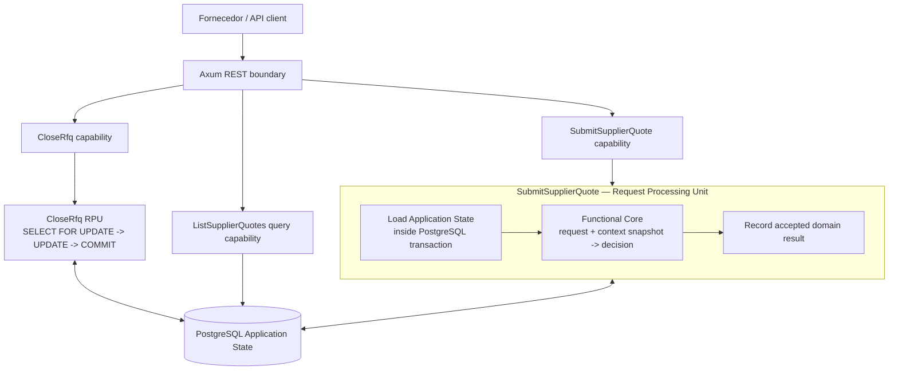

# Supplier RFQ — Domain Capabilities / RPU / CCC em Rust

Implementação de referência para **Submeter Cotação de Fornecedor** no domínio de Supply Chain, com API REST, PostgreSQL e testes de aceitação/concorrência usando Testcontainers. A nomenclatura segue a abordagem pública de Rico Fritzsche: Domain Capability, Request Processing Unit (RPU), Application State, Functional Core / Imperative Shell e Command Context Consistency (CCC).

> **Escopo:** exemplo técnico educacional, não solução de procurement pronta para produção. Não inclui autenticação/autorização, portal de fornecedores, assinatura de documentos, anexos, impostos, workflow de aprovação, seleção multicritério, idempotência HTTP ou auditoria LGPD completa.

## Stack verificada nas páginas oficiais em 23/10/2026

- [Axum 0.8.9](https://docs.rs/crate/axum/latest): roteamento HTTP e extractors; integração com Tokio/Tower.
- [SQLx 0.9.0](https://docs.rs/crate/sqlx/latest): acesso assíncrono ao PostgreSQL e migrations.
- [PostgreSQL 16](https://www.postgresql.org/docs/16/): transações, locks e constraints.
- [Testcontainers Modules 0.15.0](https://docs.rs/crate/testcontainers-modules/latest): PostgreSQL descartável em testes de integração.

## Nomenclatura e arquitetura



### Domain Capability: `SubmitSupplierQuote`

Recebe um comando com fornecedor, moeda, prazo, validade e itens ofertados. A capacidade decide se a cotação pode ser aceita, registra o resultado e devolve um resultado de negócio nomeado. O fluxo não é um `SupplierQuoteService` genérico e não delega a regra a um repositório compartilhado.

### Request Processing Unit (RPU)

O módulo `capabilities/submit_supplier_quote/process.rs` é a RPU. Ele possui o ciclo completo do comando:

1. abre a transação PostgreSQL;
2. carrega e protege o contexto do comando;
3. chama a função pura `decision::decide`;
4. se a decisão for rejeitada, faz rollback e devolve uma rejeição de negócio;
5. se aceita, grava cotação e itens na mesma transação;
6. converte conflito de unicidade esperado em rejeição de negócio;
7. commita antes de responder `201 Created`.

O módulo `state_access.rs` contém SQL de propriedade da capacidade, mas **não** inicia, commita ou esconde a transação. A RPU é dona do limite transacional.

### Application State

PostgreSQL guarda o estado operacional atual: RFQs, itens solicitados, fornecedores homologados e cotações. O schema é infraestrutura compartilhada; o significado dos dados e sua interpretação permanecem nas Domain Capabilities. Este exemplo **não usa Event Sourcing nem FACTSTR**.

### Functional Core / Imperative Shell

`decision.rs` é puro: a entrada é o comando mais um snapshot explícito (`SubmitSupplierQuoteContext`), e a saída é uma cotação calculada ou uma rejeição nomeada. Não executa SQL, não consulta relógio global, não lê variáveis de ambiente e não faz I/O. O `now` e o identificador são fornecidos de fora para manter a decisão determinística.

`process.rs`, `state_access.rs` e o handler HTTP formam a shell imperativa: coordenam transação, I/O e protocolo.

### Command Context Consistency (CCC)

CCC significa: **só registrar o resultado se os fatos em que a decisão se baseou ainda forem válidos no commit**. Não é uma biblioteca, aggregate, lock global genérico ou apenas optimistic locking; é uma obrigação de consistência que precisa ser garantida pelo mecanismo de armazenamento.

Nesta implementação relacional:

- a RPU lê `rfqs ... FOR SHARE`; `CloseRfq` usa `SELECT ... FOR UPDATE` antes de fechar. Os locks são incompatíveis, então fechar e submeter ficam ordenados pelo PostgreSQL;
- a RPU lê o fornecedor com `FOR SHARE`, protegendo seu status de homologação durante a decisão;
- os itens da RFQ são lidos `FOR SHARE`, mantendo a definição das quantidades usada no cálculo durante o processamento; um trigger bloqueia inserção/edição/exclusão dos itens depois que a RFQ sai de `draft`, protegendo também contra novos itens (phantoms) que não seriam protegidos por locks de linhas existentes;
- `UNIQUE (rfq_id, supplier_id)` é a proteção correta para a regra “um fornecedor só pode apresentar uma cotação por RFQ”. Não é seguro fazer um `SELECT NOT EXISTS` e depois inserir: duas transações concorrentes poderiam observar a ausência ao mesmo tempo;
- a violação da constraint `supplier_quotes_rfq_supplier_key` vira `duplicate_supplier_quote` (HTTP 409), pois é conflito de negócio esperado, não erro interno.

A garantia da ausência de uma cotação prévia vem da **unique constraint**, enquanto a validade do status da RFQ vem da combinação de locks e transação. Em um Event Store, a realização de CCC seria diferente: versão do contexto e append condicional, como no contrato que FACTSTR implementa.

```mermaid
sequenceDiagram
  participant A as SubmitSupplierQuote RPU
  participant B as PostgreSQL
  participant C as CloseRfq RPU
  A->>B: BEGIN
  A->>B: SELECT RFQ FOR SHARE
  C->>B: BEGIN; SELECT RFQ FOR UPDATE
  Note over B,C: Close espera enquanto Submit mantém o lock compartilhado
  A->>B: SELECT supplier/items FOR SHARE
  A->>B: INSERT quote + items
  A->>B: COMMIT
  B-->>C: lock exclusivo liberado
  C->>B: lê status atual, UPDATE closed
  C->>B: COMMIT
```

Se `CloseRfq` adquirir o lock primeiro, a submissão aguardará e, depois do commit, lerá `closed` e será rejeitada. Se a submissão adquirir o lock primeiro, ela poderá ser confirmada antes do fechamento; o fechamento aguardará e ocorrerá em seguida. Ambos os resultados são consistentes com a ordem de commit.

## Capabilities e API REST

| Capability | Tipo | Endpoint | Resultado |
|---|---|---|---|
| `SubmitSupplierQuote` | Command | `POST /api/rfqs/{rfq_id}/quotes` | `201`, ou rejeição de negócio `404`/`409`/`422` |
| `CloseRfq` | Command | `POST /api/rfqs/{rfq_id}/close` | `200`, `404` ou `409` |
| `ListSupplierQuotes` | Query | `GET /api/rfqs/{rfq_id}/quotes` | `200` ou `404`; não muda estado |
| Health | Infraestrutura | `GET /health` | `200 ok` |

Commands e Queries são capacidades distintas; `SubmitSupplierQuote` não chama `ListSupplierQuotes` para decidir, e a Query não altera o domínio.

### Exemplo de submissão

Fixture do exemplo (`scripts/seed_demo.sql`):

- RFQ: `11111111-1111-4111-8111-111111111111` (`RFQ-DEMO-2026-001`)
- fornecedor elegível: `22222222-2222-4222-8222-222222222222`
- item A: `44444444-4444-4444-8444-444444444441`, quantidade 10
- item B: `44444444-4444-4444-8444-444444444442`, quantidade 5

```bash
curl -i -X POST \
  http://127.0.0.1:3000/api/rfqs/11111111-1111-4111-8111-111111111111/quotes \
  -H 'Content-Type: application/json' \
  -d '{
    "supplier_id":"22222222-2222-4222-8222-222222222222",
    "currency":"BRL",
    "delivery_days":7,
    "valid_until":"2099-12-31",
    "items":[
      {"rfq_item_id":"44444444-4444-4444-8444-444444444441","quantity":10,"unit_price_cents":1250},
      {"rfq_item_id":"44444444-4444-4444-8444-444444444442","quantity":5,"unit_price_cents":3000}
    ]
  }'
```

Cálculo esperado: `10 × R$ 12,50 + 5 × R$ 30,00 = R$ 275,00`, armazenado como `total_amount_cents: 27500`. Valores monetários usam unidades monetárias menores inteiras, nunca `f64`.

Para consultar:

```bash
curl http://127.0.0.1:3000/api/rfqs/11111111-1111-4111-8111-111111111111/quotes
```

Para fechar a RFQ (a partir desse ponto novas cotações são rejeitadas):

```bash
curl -i -X POST http://127.0.0.1:3000/api/rfqs/11111111-1111-4111-8111-111111111111/close
```

A fixture do fornecedor bloqueado usa o ID `33333333-3333-4333-8333-333333333333`; sua submissão resulta em `409 supplier_not_eligible`.

## Estrutura do código

```text
src/
  app.rs
  application_state.rs
  database.rs
  http/handlers.rs
  capabilities/
    submit_supplier_quote/
      request.rs       # contrato de entrada
      context.rs       # snapshot explícito de fatos
      decision.rs      # Functional Core (puro)
      result.rs        # resultado e rejeições de negócio
      state_access.rs  # SQL específico da capability
      process.rs       # RPU e transação
    close_rfq/mod.rs   # command capability independente
    list_supplier_quotes/
      mod.rs           # Query capability independente
      state_access.rs  # SQL de propriedade da Query
migrations/             # schema relacional e constraints
scripts/seed_demo.sql   # fixture manual para execução local
tests/acceptance_api.rs # API real + PostgreSQL Testcontainers
```

## Executar localmente

Pré-requisitos: Rust stable compatível com `rust-version` do Cargo, Docker e Docker Compose.

```bash
cp .env.example .env
docker compose up -d postgres
cargo run
```

Em outro terminal, aplique a fixture manual:

```bash
set -a; source .env; set +a
psql "$DATABASE_URL" -f scripts/seed_demo.sql
```

A aplicação executa as migrations ao iniciar.

## Estratégia de testes

1. **Functional Core unit tests** (`decision.rs`): regras puras, total em centavos, RFQ fechada, quantidade divergente e fornecedor não homologado. Não precisam de PostgreSQL ou Docker.
2. **Acceptance tests via HTTP** (`tests/acceptance_api.rs`): usam reqwest contra servidor Axum real e PostgreSQL descartável, incluindo migrations. Validam a interface externa e o estado persistido.
3. **Concorrência na API**: duas submissões simultâneas do mesmo fornecedor/RFQ devem resultar em exatamente um `201` e um `409`, com uma única cotação persistida.
4. **Race entre `CloseRfq` e `SubmitSupplierQuote`**: permite ambos os ordenamentos, mas verifica que o RFQ termina fechado e que uma cotação só existe se a submissão tiver sido confirmada antes do fechamento.
5. **Testes no banco real**: os testes não substituem locks/constraints do PostgreSQL por mocks ou `Mutex` em memória.

Execute somente os testes puros:

```bash
cargo test --lib
```

Execute a suíte completa (precisa que Docker esteja instalado e acessível ao usuário):

```bash
cargo test
```

Se estiver rodando em um CI ou máquina com recursos limitados, prefira iniciar os containers em série:

```bash
cargo test -- --test-threads=1
```

Formate o código antes de enviar alterações e execute o lint com:

```bash
cargo fmt
cargo clippy --all-targets --all-features -- -D warnings
```

Os testes Testcontainers inicializam PostgreSQL `16-alpine` e não usam a instância do `docker-compose`. Cada teste de aceitação possui seu próprio banco descartável; isso aumenta o isolamento, embora consuma mais recursos se o runner executar vários testes em paralelo.

## Limitações deliberadas e evolução recomendada

- A constraint de unicidade codifica “uma cotação por fornecedor por RFQ”. Se o negócio permitir revisões, a identidade do comando deve incluir versão/revisão, prazo de alteração e política de substituição explícita.
- O endpoint não implementa `Idempotency-Key`. A constraint impede duas cotações para o mesmo fornecedor/RFQ, mas o cliente que perde a resposta de uma submissão aceita recebe uma rejeição de duplicidade ao repetir. Uma versão produtiva deve armazenar uma chave de idempotência e devolver o resultado original.
- `FOR SHARE` limita conflitos aos fatos relevantes. Locks compartilhados permitem que vários fornecedores submetam simultaneamente; comandos de alteração/fechamento esperam pelas submissões em curso.
- Os itens da RFQ devem ser imutáveis após abertura neste recorte. Uma capability que altere requisitos precisa definir sua própria regra de negócio e usar locks compatíveis, idealmente recusando alteração depois da primeira cotação.
- O exemplo não avalia nem escolhe fornecedor; somente aceita cotações. `EvaluateSupplierQuotes` deve ser outra capability (query/decision) e, se materializar uma adjudicação, um command RPU com contexto e CCC explícitos.
- A rejeição não é persistida para auditoria. Se a política de compliance exigir histórico de recusas, isso deve ser introduzido como uma decisão explícita e atômica, sem confundir toda falha HTTP com fato de negócio.
- O contrato da API também está em [`docs/openapi.yaml`](docs/openapi.yaml).

A API é demonstrativa e não deve ser exposta à internet sem autenticação, autorização por RFQ/fornecedor, rate limiting, limites de payload, política de timeout, TLS, gestão de segredos, auditoria e telemetria operacional.

## Referências

### Conceitos do autor

- Rico Fritzsche — [Request Processing Units](https://architecture.ricofritzsche.me/concepts/request-processing-units/)
- [Command Context Consistency](https://architecture.ricofritzsche.me/concepts/command-context-consistency/)
- [Commands and Queries](https://architecture.ricofritzsche.me/concepts/commands-and-queries/)
- [Functional Core / Imperative Shell](https://ricofritzsche.me/applying-functional-core-and-imperative-shell-in-practice/)
- [Booking a Stay — exemplo relacional em Rust e C#](https://github.com/ricofritzsche/booking-a-stay-example)
- [FACTSTR — event store Rust com append condicional e streams duráveis](https://github.com/ricofritzsche/factstr)
- [PostgreSQL concurrency proof para CCC/event sourcing](https://github.com/ricofritzsche/ccc-postgres-concurrency-proof)

### Documentação técnica

- [Axum](https://docs.rs/axum/latest/axum/)
- [SQLx](https://docs.rs/sqlx/latest/sqlx/)
- [PostgreSQL — explicit locking](https://www.postgresql.org/docs/16/explicit-locking.html)
- [PostgreSQL — unique constraints](https://www.postgresql.org/docs/16/ddl-constraints.html)
- [Testcontainers for Rust](https://docs.rs/testcontainers-modules/latest/testcontainers_modules/)
