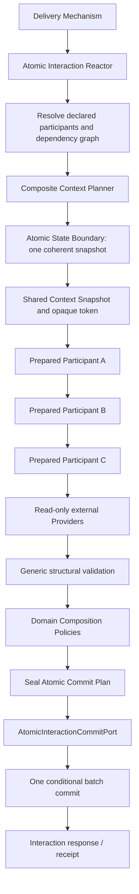
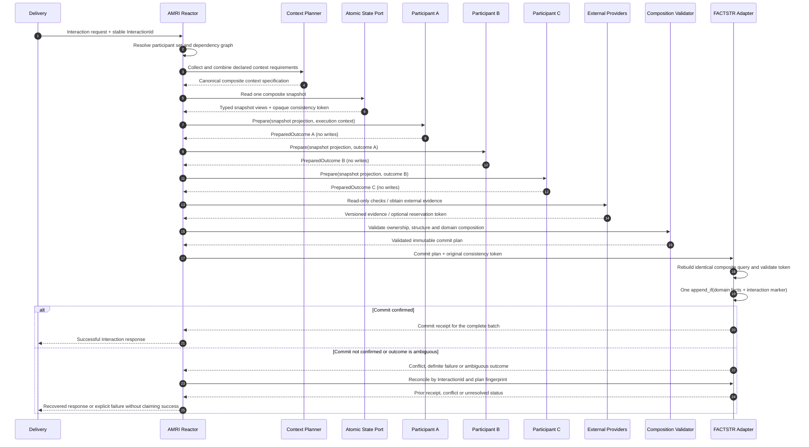

# ADR-0034: Atomic Multi-RPU Interaction (AMRI)

- **Status:** Proposed — design baseline prepared; implementation not started
- **Date:** 2026-10-30
- **Scope:** Optional protocol for coordinating three or more independent Domain Capabilities in one atomic interaction
- **Related ADRs:** ADR-0003, ADR-0004, ADR-0005, ADR-0006, ADR-0010, ADR-0011, ADR-0023, ADR-0026, ADR-0031, ADR-0033
- **Reference implementation:** `supplier-rfq-rust`, Supply Chain / RFQ

## 1. Context

The current application implements independent command RPUs. Each command RPU loads the context relevant to its capability, executes its Functional Core, and records its consequences through its Application State Provider using its own CCC boundary.

`FinalizeRfqSourcing` is a different, already implemented case: one composite Domain Capability calculates four consequences and confirms them in one FACTSTR `append_if`. It is the baseline for a single capability with multiple consequences, not an implementation of AMRI.

A new requirement is being explored: one user interaction must coordinate at least three independent capabilities. Each participant must preserve ownership of its rules and produce its own proposed consequences, but none of those consequences may become durable during preparation. The interaction must validate the complete set—including dependencies between participants and relevant external evidence—and then confirm all authorized facts together or confirm none.

Calling the existing autonomous `process` methods sequentially is insufficient: each can commit before a later participant rejects or fails. Calling several conditional appends is also insufficient: a later conflict cannot roll back an earlier committed append. A single conditional batch is required for the authoritative state changes that must be atomic together.

The official Rico Fritzsche concepts provide the vocabulary for Domain Capabilities, RPUs, Reactors, Providers, Functional Core / Imperative Shell, Application State and CCC. The consulted material does not specify a complete protocol for preparing several independent RPUs and committing their combined consequences as one batch. AMRI is therefore an explicit architectural extension to investigate—not a claim that this protocol is already part of Rico's canonical RPU or Reactor definition.

## 2. Decision drivers

1. Preserve each capability's ownership of its domain rules and facts.
2. Preserve the existing autonomous RPU contract and behavior.
3. Support at least three genuinely independent participants in the reference scenario.
4. Reuse the same Functional Core in autonomous and prepared execution; do not fork business rules.
5. Build one coherent context snapshot that covers every fact capable of invalidating any participant's decision.
6. Allow explicit data dependencies between participants without direct imports or calls between capability internals.
7. Support read-only external validation through Providers without claiming distributed atomicity.
8. Validate individual outcomes and the composed outcome before persistence.
9. Perform exactly one conditional commit to the authoritative store for the atomic set.
10. Prove the guarantees with automated unit, property, contract, integration, concurrency and recovery tests.
11. Keep the AMRI Core independent of Supply Chain, FACTSTR, PostgreSQL, SQLx, Axum and any mandatory async runtime.
12. Make AMRI opt-in so simple domains and ordinary capabilities do not inherit unnecessary complexity.

## 3. Decision summary

This ADR proposes an **Atomic Multi-RPU Interaction** protocol with an opt-in **Atomic Interaction Reactor**. The Reactor coordinates a predefined set of prepared capability participants, Providers and composition policies. Participants execute their own Functional Cores and return proposed consequences without persisting them. A single composite-context snapshot and its opaque consistency token accompany the interaction. A structural validator and domain-owned composition policies validate the complete outcome. The Reactor then requests one conditional commit through a narrow `AtomicInteractionCommitPort`; the port adapter revalidates the snapshot token and commits one batch to the authoritative store.

For the FACTSTR reference adapter, the intended persistence primitive is one `EventStore::append_if` call containing every domain fact in the batch and an AMRI interaction-commit marker used for deduplication/recovery. The exact marker payload and recovery contract must be validated before implementation. No adapter may emulate the guarantee with multiple appends.

The Reactor does not receive a raw Event Store, SQL connection or persistence implementation. However, asking for the atomic commit through an interaction-specific port is an explicit extension to the traditional Reactor boundary. This extension must remain visible in the architecture documentation and must not be presented as an unchanged canonical Rico Reactor.

## 4. Terminology

| Term | Meaning in this ADR |
|---|---|
| **Autonomous RPU** | The existing complete processing path for one capability, including its own state read and conditional write. |
| **Prepared capability participant** | An opt-in participation adapter owned by a capability. It invokes that capability's existing Functional Core and returns proposed consequences without state writes. It is not a second definition of an RPU. |
| **Atomic Interaction Reactor** | The coordinator for one declared multi-capability interaction. It sequences participants, invokes Providers and policies, and requests the final atomic commit. |
| **Composite Context Planner** | Project-specific component that combines participant context requirements and describes the one coherent snapshot required by the interaction. |
| **Shared Context Snapshot** | One read result containing the facts or typed views required by all participants, associated with one consistency token. |
| **Prepared Outcome** | An immutable, non-persisted result produced by one participant. |
| **Composition Policy** | Domain-owned pure rule(s) validating relationships across outcomes and evidence. |
| **Structural Validator** | Generic AMRI validation of participant completeness, ownership, dependency satisfaction, fact identity and batch structure. It does not decide business rules. |
| **Atomic Commit Plan** | A sealed, validated description of all facts to be committed, their deterministic order, interaction identity and snapshot token. |
| **Atomic Interaction State Boundary** | Narrow application port that reads the composite snapshot and conditionally commits a validated plan. Its adapter owns store-specific transaction/CCC mechanics. |
| **External Evidence** | Versioned or time-bounded observation from a Provider. It is evidence, not proof that an external system will remain unchanged. |

## 5. Proposed decisions

All decisions below remain **Proposed** until the corresponding implementation stage and tests demonstrate them. A code change must not silently turn a proposal into an accepted decision.

### AMRI-D01 — Opt-in per interaction

AMRI is selected only where a real business invariant requires multiple capabilities' consequences to be committed all-or-nothing. Ordinary single-capability processing remains an autonomous RPU. Multi-capability interactions that do not require atomic persistence may use a conventional Reactor without AMRI.

### AMRI-D02 — Preserve the autonomous RPU contract

The existing `process(request) -> response` behavior remains complete and unchanged. A capability that participates in AMRI exposes a separate `PreparedCapabilityParticipant` adapter. The adapter delegates to the same Functional Core as the autonomous RPU; it does not replace or weaken the autonomous contract.

### AMRI-D03 — Preparation has no durable side effects

A participant's preparation path may validate and calculate, but cannot write Application State, append facts, update projections, or perform irreversible external operations. Its port provides read-only snapshot views and explicit predecessor outcomes only. A structural boundary check and tests must enforce this restriction.

### AMRI-D04 — Reuse one Functional Core

Autonomous and prepared execution must call the same pure decision functions and rule components. If the current shell and prepared adapter duplicate a business rule, the implementation is not accepted. Extract only genuinely shared pure rules; do not make one capability call another capability's shell.

### AMRI-D05 — Declare context requirements before reading

Each participant declares the semantic facts/read dependencies required by its decision. A project-specific `CompositeContextPlanner` combines these requirements into one canonical interaction context specification. The AMRI Core does not parse a FACTSTR `EventQuery`, SQL predicate or domain-specific query language.

### AMRI-D06 — One coherent snapshot and one opaque consistency token

All prepared participants use projections of one snapshot obtained through one logical state-boundary read. Its opaque consistency token is carried unchanged to commit. Independently read versions must never be combined with `max`, arithmetic, timestamps or any other heuristic. A backend may use a scalar token, transaction snapshot, version vector or another mechanism only if its adapter proves that the token protects the entire declared read set at commit.

### AMRI-D07 — Explicit dependency graph; deterministic initial execution

The interaction declares its participants and dependencies before execution. A dependency is passed as immutable data in a typed predecessor outcome; participants do not import or invoke one another. The first implementation executes participants sequentially in a deterministic topological order. Parallel execution is deferred until independence, error handling, cancellation and deterministic batch ordering have dedicated tests. Cycles, undeclared participants and missing dependencies fail before commit.

### AMRI-D08 — Separate local decision, structural validation and domain composition

Each participant owns its local business decision. The generic structural validator checks protocol integrity: expected participants, outcome ownership, unique fact IDs, allowed fact types, dependency satisfaction, batch completeness and deterministic ordering. Domain-specific `CompositionPolicy` functions validate cross-capability business invariants. Neither set of rules belongs inside the Reactor's orchestration code.

### AMRI-D09 — Providers supply evidence; they do not create distributed atomicity

Read-only external checks may execute during the interaction and return evidence containing provider identity, external reference/revision, check time and optional expiry/reservation token. The relevant domain policy validates that evidence. A check does not freeze the external system. If the business invariant requires exclusivity, the external provider must support a reservation/lease, conditional version or equivalent guarantee. Reservations require explicit expiry and release/compensation on abort. Irreversible external actions such as actual ERP order creation occur after the internal commit through a durable dispatch/outbox process unless a real cross-system protocol exists.

### AMRI-D10 — One authoritative atomic commit boundary

All facts whose consistency must be atomic are written to one authoritative store through one `AtomicInteractionCommitPort` call. The AMRI Core and Reactor do not know the store's native query or transaction types. For the FACTSTR reference implementation, the adapter must convert the complete plan to one batch and issue exactly one `append_if` with the same composite query and version obtained by the initial snapshot. A rejected or conflicting operation must persist zero facts from that batch.

This port-mediated commit is an explicit AMRI extension to the traditional Reactor responsibility boundary. The Reactor coordinates and requests confirmation; the port adapter performs the store-specific conditional transaction. It is not permission for the Reactor to access FACTSTR or database internals.

### AMRI-D11 — Idempotency is part of the atomic interaction contract

Every interaction has a stable `InteractionId` and request/plan fingerprint. Reusing the same ID with a different semantic request is rejected. The FACTSTR reference design proposes an `amri_interaction_committed.v1` control fact appended in the same batch as the business facts. The composite consistency query includes that interaction ID: concurrent attempts from the same initial snapshot cannot both commit, because the first batch changes the marker context. On retry, the adapter detects the marker and returns an `AlreadyCommitted` receipt rather than appending again. A domain-owned recovery function reconstructs the interaction response from the receipt and committed domain facts. This marker is technical coordination evidence, not a new business capability, and domain projections must ignore it unless explicitly designed to consume it.

The marker design and its effect on the event log must be validated in the FACTSTR spike before this decision is accepted. The existing HTTP idempotency ledger remains separate; AMRI recovery must not claim a cross-table atomic write between that ledger and FACTSTR.

### AMRI-D12 — Conflict defaults to abort and full re-preparation

A stale context token causes the entire commit to fail; no participant is considered committed. Default policy is to return a context-changed result and require a new interaction/review. An interaction may opt into bounded retry only if its domain semantics allow it. A retry must obtain a fresh composite snapshot and rerun every affected participant and policy; it cannot merely resubmit the old batch. Logical InteractionId and captured execution metadata remain stable for a retry of the same logical interaction. Human selections and other non-repeatable decisions must not be silently re-evaluated against a changed context.

### AMRI-D13 — Core and protocol are domain/store agnostic

The reusable Core contains protocol types and deterministic composition mechanics only. It must not depend on RFQ, supplier, quote, purchase-order, tax or ERP concepts; nor on FACTSTR, PostgreSQL, SQLx, Axum, a message broker or a mandatory async runtime. Domain facts remain typed in the owning application. A codec/adapter translates those facts at the persistence boundary. No universal JSON payload is mandated by the Core.

### AMRI-D14 — Store adapters must prove semantic conformance

An adapter is AMRI-compatible only if contract tests prove: coherent snapshot semantics, token binding to the complete read set, atomic all-or-none batch commit, conflict detection for relevant changes, no false conflicts beyond the declared consistency boundary where the backend permits that distinction, idempotency-marker uniqueness, and recovery behavior. A backend unable to demonstrate these guarantees cannot advertise AMRI atomicity. PostgreSQL relational support is not assumed merely because it supports transactions; isolation, phantom protection, locking and constraints must be explicitly designed and tested.

### AMRI-D15 — Error categories and observability are explicit

The protocol distinguishes at least participant business rejection, composition rejection, invalid/missing participant, dependency failure, external provider failure, stale external evidence, context conflict, interaction-ID/fingerprint mismatch, definite commit failure and ambiguous commit outcome. Every interaction is correlated by InteractionId and records participant start/result, context specification fingerprint, plan fingerprint, commit attempt/result and external evidence references without leaking sensitive payloads.

### AMRI-D16 — Long-running workflows are outside the initial atomic request boundary

The initial AMRI implementation is a bounded interaction, not a durable workflow engine. Human approval waits, long-running external processes, or reservations that cannot remain valid through the interaction require a separate durable process manager/saga. The system must not hold a database transaction or FACTSTR lock while waiting on network Providers or human decisions.

## 6. Target processing protocol



The diagram shows the minimum three participants for the reference scenario; the protocol supports a declared number `N >= 1`. The Supply Chain acceptance scenario must use at least three independent capabilities. The initial implementation uses three sequential participants with explicit dependencies. Provider calls happen outside any open storage transaction.

### 6.1 Detailed sequence



### 6.2 Participant execution rules

- The participant set and dependency graph are fixed for one interaction definition/version.
- Each participant receives only the typed context projection and predecessor outcomes it needs.
- The participant cannot query the authoritative store or call another participant's shell.
- A participant returns a typed outcome and zero or more proposed facts. Returning no facts is valid only when explicitly allowed by that participant contract.
- A rejected participant aborts preparation; no commit is requested.
- The initial implementation is sequential. Any future parallel participant execution must prove that participants are independent, have no hidden shared mutable state, and produce the same deterministic plan regardless of scheduling.

## 7. Context consistency and commit semantics

The composite read set is the union of all facts that could invalidate any participant decision or composition policy. The project-specific planner owns semantic merging. A backend adapter translates the canonical specification to its own query/transaction mechanism.

For FACTSTR 0.5.2, the reference adapter must construct one `EventQuery` containing the union of required filters, read its `current_context_version`, and preserve the exact normalized query for `append_if`. The query's OR/AND semantics are part of the contract and must be covered by tests. No individual participant version is combined to produce the commit token.

For a relational backend, one repeatable-read transaction alone is not automatically sufficient to protect against all phantom inserts or write skew. The adapter must use an appropriate serializable strategy, predicate/advisory/entity locks, version guards and/or database constraints, then prove its behavior with concurrent acceptance tests. No generic claim of equivalent correctness is allowed until those tests pass.

The consistency token is opaque to the Core and Reactor. The adapter binds it to the snapshot specification and store instance. A token from another adapter, interaction, snapshot or requirement set must be rejected.

A successful atomic commit confirms the full ordered batch. A business rejection, composition rejection, external evidence failure, stale token, storage rejection or definite failure before commit confirms none of the batch. If the client loses the response after the store commits, the interaction marker supports idempotent recognition and domain-specific response reconstruction; it does not make the HTTP ledger and FACTSTR one distributed transaction.

## 8. Fact ownership, composition and ordering

Each participant declares which fact contracts it may propose. The structural validator rejects facts outside that allowlist, duplicate fact identities, missing required participants, unmet dependencies, unsupported schema versions, an incomplete batch or an invalid plan fingerprint.

Cross-capability domain invariants belong to pure, domain-owned composition policies. For the RFQ example, these policies must establish at least that:

- the close consequence addresses the same RFQ used by the interaction;
- the award points to the reviewed quote and selected supplier;
- the selected quote belongs to the same RFQ and supplier;
- the purchase order derives from the awarded quote and preserves its commercial terms;
- item identities, quantities, currency and monetary totals remain consistent;
- the dispatch intent references the created purchase order;
- no already-finalized or duplicate sourcing outcome is introduced.

The generic Core must not know these invariants. It validates protocol structure and invokes the domain-owned policies.

The batch has deterministic ordering defined by the versioned interaction definition and participant dependency graph, not by hash-map iteration or task completion order. The persistence adapter encodes typed facts and the technical interaction marker. No participant receives the ability to append directly.

## 9. External Providers and the boundary of atomicity

AMRI atomicity applies to one authoritative state store. It does not atomically commit an ERP, tax service, supplier portal, or another independent system.

Read-only validation evidence may be included in the commit plan or relevant domain facts, with provenance, external revision/reference, checked time and expiry. This records what was validated; it does not freeze the external source.

When an external resource must remain available or unchanged, the provider must offer a reservation/lease, conditional version or equivalent. The protocol must track the reservation and release or compensate it when internal commit fails. The first RFQ experiment uses fake read-only Providers and does not create a real ERP order before commit.

Actual external dispatch is a post-commit operation driven by a durable dispatch fact/consumer. Retry, downstream idempotency, reconciliation and dead-letter handling are separate responsibilities. No distributed transaction is claimed.

## 10. Idempotency and recovery

`InteractionId` is stable for the logical interaction and is bound to a normalized semantic request fingerprint. Same ID plus different fingerprint is a hard rejection. The proposed FACTSTR marker `amri_interaction_committed.v1` is part of the same append batch as the business facts. The marker's context predicate is included in the same conditional query used for the initial snapshot.

Two attempts using the same initial snapshot and InteractionId may both prepare, but cannot both confirm: the winning append also adds the marker, changing the marker query context. The losing append receives a context conflict. A later retry reads the marker and returns `AlreadyCommitted` with a receipt and recovery references. Domain-specific recovery reconstructs the outward result from committed facts. The exact event payload and recovery API are a required spike/gate, not an assumed feature of FACTSTR.

The existing HTTP idempotency ledger is not atomically committed with FACTSTR. AMRI must use the authoritative interaction marker to resolve the ambiguous case where FACTSTR committed but the delivery layer did not record or return the response. Tests must demonstrate reconciliation without appending duplicates.

## 11. Rust module boundaries — proposed, not final API

The Core may be organized by concept, not by a premature deep hierarchy:

```text
src/amri/
  mod.rs
  identity.rs
  participant.rs
  execution.rs
  context.rs
  outcome.rs
  composition.rs
  commit_plan.rs
  error.rs
  reactor.rs
```

Application-specific adapters remain outside the generic Core:

```text
src/atomic_interactions/rfq_sourcing/
  mod.rs
  definition.rs
  context_plan.rs
  participants/
    close_rfq.rs
    award_supplier_quote.rs
    create_purchase_order.rs
  providers/
    erp_reference.rs
    tax_compliance.rs
  composition_policies.rs
  recovery.rs
  reactor.rs

src/application_state/
  atomic_interaction.rs
  factstr_atomic_interaction.rs
```

This is a candidate layout only. The first code spike must demonstrate that the boundaries are useful before creating every module. Prefer feature-first slices and avoid generic registries, dynamic loading, macros or type-erasure frameworks until a demonstrated requirement needs them.

Candidate contracts (illustrative only; do not copy directly into production without the Stage 1 design review):

```rust
trait PreparedCapabilityParticipant {
    type Request;
    type ContextView;
    type PreviousOutcomes;
    type Outcome;

    fn prepare(
        &self,
        request: Self::Request,
        context: Self::ContextView,
        previous: Self::PreviousOutcomes,
        execution: &ExecutionContext,
    ) -> Result<Self::Outcome, ParticipantRejection>;
}

trait AtomicInteractionState {
    type Snapshot;
    type ConsistencyToken;

    fn read_composite_context(
        &self,
        specification: &CompositeContextSpecification,
    ) -> Result<SnapshotEnvelope<Self::Snapshot, Self::ConsistencyToken>, StateReadError>;

    fn commit_if_unchanged(
        &self,
        token: &Self::ConsistencyToken,
        plan: ValidatedAtomicCommitPlan,
    ) -> Result<CommitResolution, AtomicCommitError>;
}
```

The actual API must decide how typed participant context projections and heterogeneous outcomes are composed in Rust. Start with static, explicitly typed composition for the three-participant pilot. Introduce type erasure or dynamic registration only if a second use case demonstrates the need. The Core must not require `serde_json::Value` as the universal fact representation.

## 12. Test and evidence requirements

No AMRI implementation stage is complete because it compiles. Every architectural decision must trace to executable evidence or be explicitly marked as requiring human review.

| Property | Minimum automated evidence | Infrastructure |
|---|---|---|
| Autonomous RPU unchanged | Existing acceptance and contract suite remains green | Existing suite |
| Participant preparation has no writes | Port-level tests plus structural guard; zero appended facts after every prepare/rejection path | Fake state and PostgreSQL acceptance |
| Same Functional Core reused | Parity tests for equivalent autonomous/prepared inputs and outcomes | Pure tests |
| One composite context | Planner tests prove requirement union, de-duplication and one read invocation | Pure tests + fake state |
| Token is never combined | Tests reject independent snapshots/tokens and tokens from a different plan/provider | Pure/contract tests |
| Participant graph | Tests for ordering, missing nodes, duplicate nodes, unsatisfied dependencies and cycles | Pure tests |
| Local decisions | Detailed outcome matrix for every participant | Pure tests |
| Composition rules | Positive/negative cross-capability combinations | Pure tests + property tests |
| External evidence | Provider timeout, unavailable, stale, mismatched revision and reservation expiry | Fake providers |
| Structural plan validation | Unauthorized facts, duplicate identities, invalid version, incomplete batch and altered digest are rejected | Pure tests |
| Single atomic write | Exactly one append call; one committed batch contains all business facts and marker | FACTSTR/PostgreSQL Testcontainers |
| All-or-none behavior | Rejection/conflict/invalid batch stores zero facts from the interaction | Testcontainers |
| CCC race | Two independent stores prepare against the same snapshot, synchronize immediately before commit; at most one commits | Deterministic Testcontainers |
| Concurrent autonomous RPU | Existing RPU write invalidates AMRI when it changes a relevant context | Testcontainers |
| No false logical conflicts | Changes outside the declared composite context do not invalidate the interaction where the backend contract permits | Testcontainers |
| Idempotency marker | Same ID/same fingerprint returns existing receipt; same ID/different fingerprint rejects; concurrent duplicate appends one batch | Testcontainers |
| Ambiguous response recovery | Simulated loss after confirmed append, followed by retry and reconstruction without a second append | Testcontainers + fault injection |
| Batch ordering | Identical logical plan always produces identical event order | Pure/property tests |
| Portability | Core compiles/tests without storage, delivery or RFQ dependencies; second domain reuses protocol contracts | Compile checks + second example |

### Mandatory quality gates

Preserve existing gates and add AMRI-specific checks only as their implementation exists:

```bash
cargo fmt --all -- --check
cargo check --all-targets --all-features --locked
cargo test --all-targets --all-features --locked
cargo clippy --all-targets --all-features --locked -- -D warnings
bash scripts/verify-rpu-boundaries.sh
bash scripts/verify-application-state-boundary.sh
bash scripts/verify-functional-core-test-isolation.sh
bash scripts/verify-amri-boundaries.sh
bash scripts/verify-openapi.sh
sh scripts/verify-mermaid-diagrams.sh
bash scripts/verify-documentation-current-state.sh
bash scripts/coverage-functional-core.sh
bash scripts/mutate-functional-core.sh
```

Only run `verify-amri-boundaries.sh` after it is introduced. The mutation runner must target pure Functional Core, AMRI Core and pure composition policies only; it must never launch Testcontainers or mutate infrastructure code. Coverage applies only to explicitly listed production decision modules and must not be described as whole-crate coverage. Mutation testing may remain scheduled/manual in CI, but its result must be recorded separately from ordinary push CI.

## 13. Incremental implementation plan

| Stage | Scope | Required output | Exit gate |
|---|---|---|---|
| 0 | Baseline and protection | Baseline report, current CI evidence, unchanged-code inventory | Reproducible remote baseline; local checks explicitly distinguished |
| 1 | ADR and protocol design | Accepted ADR, protocol, consistency model, applicability and diagrams | No unresolved contract ambiguity that blocks a code spike |
| 2 | AMRI Core | Minimal identities, execution context, outcomes, plan and error types | Pure tests, property tests, coverage and mutation; no DB |
| 3 | Composite context and state port | Context planner contract, coherent snapshot/token, FACTSTR adapter spike | Adapter contract tests and stale-token proof |
| 4 | Three Supply Chain participants | Close, award and create-PO prepared participants reusing existing Functional Cores where possible | Each participant independently tested; preparation performs no writes |
| 5 | Reactor and Providers | Deterministic coordinator, dependency graph and fake external evidence | Order, abort, timeout, stale evidence and no-write tests |
| 6 | Composition and commit plan | Structural validator, domain policies and sealed deterministic plan | Invalid combinations cannot produce a valid plan |
| 7 | Atomic FACTSTR commit | One `append_if`, marker and recovery contract | Testcontainers atomicity, CCC races, duplicate interaction and ambiguous response tests |
| 8 | Operational hardening | Bounded retries policy, telemetry, fault injection, performance and load measurements | Reproducible recovery and documented throughput/latency limits |
| 9 | Generalization proof | Second simple/different domain and adapter conformance documentation | Core reused without Supply Chain types or infrastructure dependencies |

Each stage is a separate reviewable delivery. Do not combine the entire architecture into one large refactoring script. Every stage updates the ADR status, decision log, architecture diagrams, evidence matrix and implementation checklist as appropriate.

## 14. Alternatives considered

### A. Keep one composite capability/RPU (`FinalizeRfqSourcing`)

**Retained as baseline.** It is simpler and fully appropriate where one business capability owns the combined decision. It does not satisfy the new requirement to demonstrate three independent capability participants.

### B. Call existing autonomous RPUs sequentially from a Reactor

**Rejected for AMRI.** Each RPU can commit independently; a later rejection or failure leaves earlier effects durable.

### C. Have each participant issue its own `append_if`

**Rejected.** Multiple commits do not provide all-or-none semantics. A later conflict cannot roll back an earlier append.

### D. Use three separate reads and combine their context versions

**Rejected.** Independent reads may observe different snapshots. Combining maximum versions does not create a coherent snapshot or protect the union of their read sets.

### E. Let participants write into one shared database transaction

**Not selected for the first implementation.** It can be viable for relational storage if all participants share a transaction and the adapter proves isolation/locking/constraint semantics. It is not the FACTSTR public API contract and would leak backend transaction mechanics into participants. A separate relational adapter may be explored after the generic contract is proven.

### F. Distributed transaction across FACTSTR and external systems

**Rejected as an assumption.** No such protocol is currently demonstrated. External side effects require reservation, outbox, idempotency, reconciliation or saga semantics.

### G. Create a universal workflow engine

**Rejected.** AMRI is a bounded atomic interaction protocol, not a general workflow engine, scheduler, BPMN runtime or long-running process manager.

## 15. Consequences and risks

### Positive

- Preserves the ownership of independent capability decisions.
- Avoids partial facts from intermediate participant commits.
- Makes the full read set and commit boundary explicit.
- Separates participant decisions, composition policy, external evidence and persistence mechanics.
- Offers a reusable protocol for domains with different complexity levels.

### Negative / residual risks

- Prepared participation is an explicit extension around the canonical RPU lifecycle and requires precise naming/documentation.
- Composite read sets may be wider than an individual RPU context and may increase logical conflicts.
- FACTSTR's current PostgreSQL append implementation serializes appends with exclusive table locks; AMRI does not remove that physical contention. Benchmark the actual batch and read-set sizes.
- The technical interaction marker adds an event type and must be ignored by domain projections unless explicitly handled.
- Reconstructing the exact response after a lost reply needs a domain-owned recovery contract.
- External evidence can become stale after validation; strong external invariants require provider-supported reservations or conditional operations.
- More generic abstractions create complexity and must be justified by a second domain before extraction into a standalone crate.

## 16. Acceptance criteria for this ADR

This ADR may move from Proposed to Accepted only when:

1. The Rust contracts and ownership boundaries are reviewed and settled.
2. The one-snapshot/one-token design is proven against FACTSTR's actual query semantics.
3. The three-participant RFQ scenario passes all required all-or-none and concurrency tests.
4. Idempotency marker and ambiguous-response recovery are demonstrated.
5. Existing autonomous RPUs and all existing quality gates remain green.
6. Structural checks prove the Core/participant/Reactor/adapter boundaries.
7. The second-domain portability experiment demonstrates that the Core is not Supply Chain-specific.
8. Documentation and evidence matrices match the implementation; no proposed feature is reported as implemented prematurely.

## 17. References

### Rico Fritzsche — primary architecture concepts

- [Architecture Knowledge Base](https://architecture.ricofritzsche.me/)
- [Domain Capability](https://architecture.ricofritzsche.me/concepts/domain-capability/)
- [Request Processing Units](https://architecture.ricofritzsche.me/concepts/request-processing-units/)
- [Reactors](https://architecture.ricofritzsche.me/concepts/reactors/)
- [User Interactions](https://architecture.ricofritzsche.me/concepts/user-interactions/)
- [Delivery Mechanisms](https://architecture.ricofritzsche.me/concepts/delivery-mechanisms/)
- [Providers](https://architecture.ricofritzsche.me/concepts/providers/)
- [Functional Core / Imperative Shell](https://architecture.ricofritzsche.me/concepts/functional-core-imperative-shell/)
- [Application State Provider](https://architecture.ricofritzsche.me/concepts/application-state-provider/)
- [Command Context Consistency](https://architecture.ricofritzsche.me/concepts/command-context-consistency/)
- [Event Store API specification](https://architecture.ricofritzsche.me/specifications/command-context-consistency/event-store-api/)

### Reference implementations

- [FACTSTR](https://github.com/ricofritzsche/factstr)
- [FACTSTR Tool Rental Example — Rust](https://github.com/ricofritzsche/factstr-tool-rental-example/tree/main/rust)
- [Booking a Stay — Rust](https://github.com/ricofritzsche/booking-a-stay-example/tree/main/rust-example)
- [Supplier RFQ — current reference implementation](https://github.com/israelsantiago/supplier-rfq-rust)

### Related local decisions

- [ADR-0006 — Command Context Consistency](./0006-command-context-consistency.md)
- [ADR-0023 — No cross-RPU orchestrator in the previous scope](./0023-no-cross-rpu-orchestrator.md)
- [ADR-0026 — Application State Provider](./0026-application-state-provider.md)
- [ADR-0031 — Atomic sourcing as one capability](./0031-atomic-rfq-sourcing-finalization.md)
- [ADR-0033 — Specialized Application State ports](./0033-application-state-provider-specialized-ports.md)
