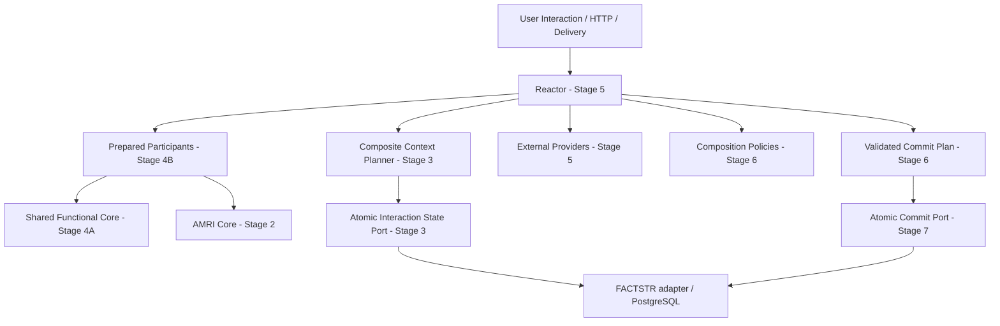
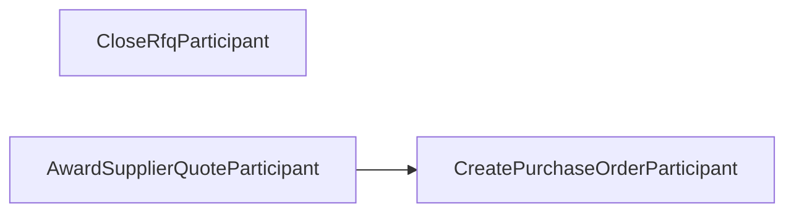
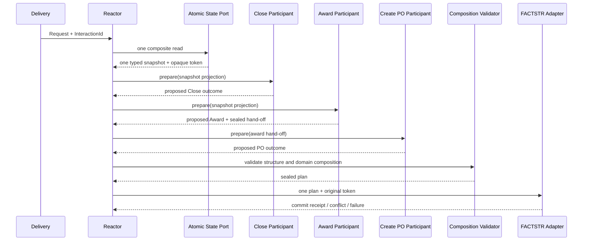

# Arquitetura AMRI — responsabilidades e fronteiras

## 1. Motivação e aplicabilidade

AMRI (*Atomic Multi-RPU Interaction*) é uma extensão arquitetural proposta para uma interação limitada que precisa coordenar três ou mais capacidades independentes, preparar consequências sem escrita intermediária e confirmar o conjunto autorizado em uma única fronteira atômica de Application State.

AMRI não substitui RPU autônomo, Reactor convencional, FACTSTR, Application State ou um motor de workflow. Só deve ser usada quando a regra de negócio exige atomicidade all-or-none entre consequências pertencentes a capabilities distintas. Se uma capability só produz quatro fatos sob uma única decisão, uma RPU composta simples pode ser melhor — esse é o caso de `FinalizeRfqSourcing`.

## 2. Modelo de responsabilidades

| Elemento | Responsabilidade | Não deve fazer |
|---|---|---|
| Domain Capability | Uma capacidade de comando ou consulta, com linguagem e regras próprias | Coordenar outras capabilities |
| RPU autônomo | Contrato completo `process(request) -> response`; carrega contexto, decide, grava consequência e responde | Chamar outra RPU |
| Functional Core | Decisão pura com entrada explícita e saída determinística | Ler relógio/store, gerar IDs aleatórios, I/O |
| Imperative Shell | Capturar providers, carregar contexto, chamar Core, registrar consequências e responder | Transferir regra de negócio para adaptador técnico |
| Prepared Participant | Adaptador opt-in que chama o mesmo Functional Core e devolve `PreparedOutcome`/`ProposedFact` em memória | Persistir, consultar store ou invocar shell de outra capability |
| AMRI Core | Identidades, definição, dependências, resultados preparados, validação estrutural e plano tipado | Conhecer RFQ, FACTSTR, SQLx, PostgreSQL, Axum, JSON universal ou fornecedor externo |
| Composite Context Planner | Unir semanticamente os requisitos de leitura dos participantes e definir a especificação do contexto | Decidir regra de negócio ou conhecer a query nativa do store |
| Atomic Interaction State Port | Uma leitura coerente e operação de confirmação condicional | Implementar políticas de negócio |
| Adapter FACTSTR | Traduzir a especificação para EventQuery, preservar token/query e executar batch `append_if` | Alterar regras do Core |
| Reactor (Stage 5) | Coordenar participantes, dependências, providers/policies, abort e solicitação de commit | Conter regra de domínio ou acessar EventStore/SQL diretamente |
| Provider externo | Acessar recurso fora do domínio e devolver evidência | Fingir transação distribuída ou garantir exclusividade sem protocolo de reserva |
| Composition Policy (Stage 6) | Validar invariantes cruzadas de domínio | Fazer I/O ou persistência |

## 3. Arquitetura em camadas



O diagrama descreve o alvo, não o estado atual. A implementação Stage 4B adiciona apenas os adaptadores preparados e sua definição declarativa; não adiciona Reactor, policies nem commit da interação.

## 4. Duas formas de execução, um mesmo Core

### RPU autônoma (preservada)

```text
request -> Imperative Shell -> context próprio -> Functional Core
        -> Application State Provider -> CCC/append_if próprio -> response
```

### Participação AMRI (preparação)

```text
interaction -> Prepared Participant -> projeção do snapshot comum
             -> o mesmo Functional Core -> PreparedOutcome + ProposedFact
             -> retorno ao coordenador; nenhum write
```

A preparação não é um RPU autônomo incompleto. É um adaptador explicitamente limitado para uma interação coordenada. Os contratos públicos existentes das RPUs permanecem preservados.

## 5. Baseline único `FinalizeRfqSourcing`

`FinalizeRfqSourcing` é uma capability/RPU própria. Sua decisão calcula quatro consequências (`RfqClosedFact`, `RfqAwardedFact`, `PurchaseOrderCreatedFact`, `PurchaseOrderDispatchRequestedFact`) e sua shell usa uma única operação FACTSTR `append_if`. Não chama as RPUs legadas, não coordena três participantes e não é Reactor nem AMRI. É a comparação de baseline para uma capability única com várias consequências.

O Stage 4A extrai decisões puras reutilizáveis para `src/domain/` e mantém `FinalizeRfqSourcing::decide`/shell e a ordem histórica de rejeições. Isso não transforma a capability em AMRI.

## 6. Componentes existentes

### AMRI Core — Stage 2

`src/amri/` contém tipos genéricos, identidades tipadas, fingerprint opaco, `ExecutionContext`, `ParticipantDefinition`, `InteractionDefinition`, `PreparedOutcome`, `ProposedFact`, validação estrutural, ordenação topológica determinística e `ValidatedCommitPlan`.

### Composite context e state port — Stage 3

O contrato de aplicação está sob `src/application_state.rs` e o módulo `atomic_interaction`. Ele combina requirements, snapshot e token opaco e tem adapter FACTSTR. O Core não manipula `EventQuery` nem token FACTSTR.

O token deve proteger a união completa do contexto lido. Nunca combinar versões independentes com `max`, timestamp ou heurística. O mesmo token opaco e a especificação/query exata devem ser usados na confirmação.

### Shared Functional Core — Stage 4A

`src/domain/rfq_lifecycle.rs` e `src/domain/sourcing.rs` contêm as decisões compartilhadas. São código puro e não devem depender de Providers, estado, FACTSTR, PostgreSQL, SQLx, HTTP, relógio ou aleatoriedade.

### Prepared participants — Stage 4B (alvo)

`src/amri_participants/` é módulo de aplicação/domínio da referência RFQ, separado do `src/amri/` genérico. Participantes concretos usam decisões do Shared Functional Core e devolvem tipos AMRI. A definição de participantes é metadado estático nesta fase.

## 7. Grafo de participantes RFQ



- Close e Award são independentes.
- PO depende de Award porque a decisão requer o hand-off validado.
- O hand-off `AwardedSupplierQuote` contém `RfqAwardedFact` e a cotação original validada, inclusive suas linhas. Só o award fact não carrega os detalhes da cotação necessários para o PO.
- Close e Award devem receber projeções do mesmo snapshot pre-interação; Stage 4B não adquire nem combina tokens.
- Não adicionar aresta Close → Award nem mutar `SourcingContext.closed` para refletir uma consequência ainda não confirmada.

## 8. Sequência conceitual futura



A sequência completa ainda não está implementada. O commit e a recuperação aparecem apenas após Stage 7.

## 9. Atomicidade e limite externo

A atomicidade AMRI cobre um único Application State autoritativo. Não existe atomicidade automática com ERP, portal do fornecedor, serviço fiscal ou outro sistema. Checks externos são evidência temporal; se exclusividade for indispensável, o sistema externo precisa suportar reserva/lease, versão condicional ou garantia equivalente. Dispatch externo efetivo deve acontecer após o commit por fato/outbox/consumer durável.

Não manter transação/lock de storage aberto durante chamada de rede ou espera humana. AMRI inicial é uma interação curta, não workflow durável.

## 10. API pública experimental

A proposta Stage 4B expõe `crate::amri_participants` e promove `crate::domain` de `pub(crate)` para `pub`, porque tipos de domínio aparecem em assinaturas públicas dos participantes. Isso evita API pública com parâmetros de visibilidade efetiva mais restrita e evita supressões `dead_code`. É um alargamento real da superfície pública: deve ser revisado no diff, documentado como experimental e não interpretado como garantia de estabilidade ou aceitação da ADR-0034.

Referência de linguagem: [Rust Reference — visibility and privacy](https://doc.rust-lang.org/reference/visibility-and-privacy.html).
