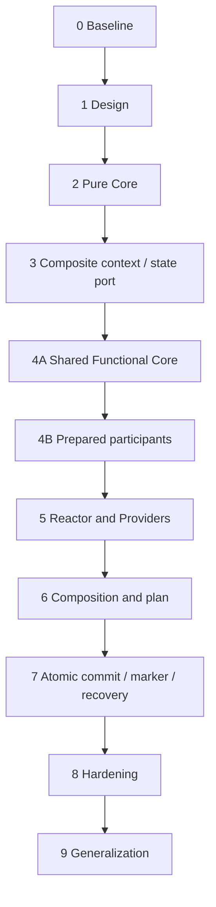

# Plano completo de implementação AMRI — roadmap e gates

<!-- AMRI-STAGE5B3R-PLAN-CHECKPOINT-20261121:START -->

## Estado vigente do plano — 2026-11-21

As seções e checklists mais antigos deste arquivo são histórico dos change sets já executados; a matriz e os gates deste checkpoint prevalecem como plano corrente.

| Subetapa | Estado | Critério/limite |
|---|---|---|
| 5B.2 — External Read-only Providers | Evidência de implementação revisada; encerramento recomendado com limitações | 17/17 PASS; 11 gates frescos, 6 históricos reutilizados com 12 logs validados. Mutation SKIPPED por política. CI remoto sem confirmação. Não repetir os 17 gates sem mudança material. |
| 5B.3-R — Reconciliação documental | Em execução neste change set | Sincronizar current-state, plano, decisão, evidências, histórico, README e chat-handoff; registrar incidentes dos publishers; criar handoff de 5C. Encerramento após push confirmado. |
| 5C — Reactor | Discovery gate; sem implementação de produção autorizada | Primeiro identificar interação/call-site real na Application/Delivery. Se nenhum consumidor justificar atomicidade entre capabilities distintas, produzir blocker report e parar. |
| 6 — Composition Policies + Commit Plan | Pendente | Não antecipar na 5C. |
| 7 — Commit atômico, marker e recovery | Pendente | Primeiro estágio com escrita AMRI; não antecipar na 5C. |

### Gates de saída desta reconciliação 5B.3-R

- `git apply --stat` e `git apply --check` no HEAD base exato; parser de arquivos/hunks e EOF; backup verificável.
- Allowlist documental fechada; nenhum arquivo Rust, Cargo, workflow, ADR ou código de produção alterado.
- `git diff --check`, `bash scripts/verify-documentation-current-state.sh` e `bash scripts/verify-mermaid-diagrams.sh`.
- Receipt `all_gates_pass=true`, `progress=COMPLETED`, hashes finais e backup; commit/push em comandos separados, fast-forward somente.
- Após publicação, atualizar handoff e tratar Stage 5B.3-R como encerrada. ADR-0034 permanece Proposed.

<!-- AMRI-STAGE5B3R-PLAN-CHECKPOINT-20261121:END -->

O plano detalhado original permanece em [`../implementation-plan.md`](../implementation-plan.md). Este arquivo expande o plano em tarefas executáveis, subetapas e regras de entrada/saída. Cada fase deve gerar um commit/push verificável na mesma branch, após revisão.

## Visão geral

| Fase | Descrição | Estado em 2026-11-20 |
|---|---|---|
| 0 | Baseline e proteção | Concluída anteriormente |
| 1 | ADR/protocolo/documentação | Concluída como design; ADR-0034 Proposed |
| 2 | Core AMRI puro | Implementada/verificada anteriormente |
| 3 | Context planner + atomic state port | Implementada/verificada anteriormente |
| 4A | Shared Functional Core | Implementada, verificada pelo mantenedor, publicada |
| 4B | Prepared participants RFQ | Implementada, publicada e verificada localmente; Audit V3: 10 gates PASS em 2026-11-04 |
| 5 | Reactor + Providers | 5B.2 re-verificada; 5B.3-R documental em andamento; Stage 5C seguinte |
| 6 | Composition policies + commit plan | Pendente |
| 7 | Atomic FACTSTR commit, marker e recovery | Pendente |
| 8 | Hardening/performance/observabilidade | Pendente |
| 9 | Segundo domínio/generalização | Pendente |

## Regra de ciclo de vida de cada fase

1. Confirmar estado da janela de contexto de forma qualitativa, sem inventar percentual.
2. Ler `current-state.md`, o arquivo da fase e o código real na branch remota/local.
3. Confirmar branch, HEAD, origin e working tree limpo.
4. Fazer análise de impacto e allowlist de arquivos antes de gerar patch.
5. Criar scripts idempotentes e fail-closed; padrão `--dry-run`.
6. Testar scripts/transformações em fixtures isoladas.
7. Revisar diff completo e hashes.
8. Aplicar com backup e rollback.
9. Rodar gates específicos, preservando a distinção entre testes executados e pulados.
10. Revisar diff/status e criar commit separado.
11. Push fast-forward sem force; verificar o HEAD remoto.
12. Atualizar logs/documentos e só então abrir próxima fase.

## Guardrails de automação

As regras transversais para scripts, artefatos, backups, diffs, hashes, gates e publicação estão em [engineering-guardrails.md](./engineering-guardrails.md). Aplicam-se a todas as fases.

## Fases individuais

Ver `stages/` para os detalhes executáveis: `stage-00` a `stage-09`, com Stage 4 dividida em `stage-04a` e `stage-04b`.

## Ordem obrigatória de dependências

## Regras de não antecipação

- Stage 4B não implementa Reactor nem chama ports.
- Stage 5 não implementa composição de regras de negócio que pertence à Stage 6.
- Stage 6 não grava no storage nem implementa marker/recovery.
- Stage 7 é o primeiro estágio de integração AMRI com commit real, um único `append_if` no adapter.
- Stage 8 não altera semântica de negócio para acomodar benchmarks; registra limites/telemetria/recovery.
- Stage 9 prova reuse com outro domínio antes de considerar extração em crate.

## Critério de conclusão global da ADR-0034

A ADR só pode mudar de `Proposed` para `Accepted` quando todos os critérios finais do ADR-0034 forem demonstrados: contracts/ownership revisados; snapshot/token comprovados; cenário de três participantes atômico; marker e recovery; testes existentes verdes; boundary guards; segundo domínio; documentação alinhada. Stage 4A/4B concluídas não aceitam AMRI completo.

## Change set vigente — Stage 5B.1

1. Fixar Rust 1.100.0 em `rust-toolchain.toml` e nos jobs estáveis do GitHub Actions; manter o job de cobertura em nightly explícito.
2. Corrigir o teste `rejects_sum_overflow_across_valid_line_totals` com iteração pareada, eliminando `clippy::needless_range_loop` sem suprimir o lint.
3. Implementar na Application `RfqSourcingExecutionContextFactory`, reutilizando `ClockProvider` e `IdProvider`.
4. Definir fingerprint SHA-256 v1 com domain separation e campos de tamanho fixo; testar vetor conhecido, determinismo e sensibilidade a cada campo.
5. Garantir captura única de timestamp/InteractionId e documentar que o `ExecutionContext` deve ser reutilizado nos retries da mesma execução lógica.
6. Executar localmente os jobs obrigatórios do workflow; o Clippy deve ser o Clippy da toolchain 1.100.0.

Não adicionar endpoints externos, adapters de ERP, Reactor, política cross-capability, `append_if`, Interaction Marker ou Recovery neste change set.

<!-- AMRI-STAGE5B2-STAGE-PLAN:START -->

## Change set — Stage 5B.2: External Read-Only Providers

**Estado:** design/implementação empacotados; Apply e gates no checkout do mantenedor pendentes.

### Escopo

1. Definir portas síncronas Application para ERP Reference, Compliance e Tax com entradas baseadas no `supplier_id` já existente.
2. Usar resultados `Found`, `NotFound` e `NotApplicable`, distintos de `Unavailable`, `TimedOut` e `InvalidResponse`.
3. Preservar apenas referência externa, revisão e tempos de observação/expiração; não criar verdictos de Compliance nem dados/cálculos fiscais.
4. Definir Fakes determinísticos sob `cfg(test)`/feature `test-support`.
5. Definir contratos OpenAPI versionados e test doubles HTTP somente para integração. `wiremock` crate 0.6.5 roda em um binário Rust próprio e é iniciado com Testcontainers `GenericImage`.
6. Manter `wiremock-rs` e Testcontainers fora de `src/amri/`, `src/domain/` e dos testes de lógica pura.

### Exclusões

Sem endpoints reais, credenciais, SDKs, writes, integração de produção, Reactor 5C, policies Stage 6, append/marker/recovery Stage 7, timeout com espera artificial, `sleep` ou Docker nos testes unitários/core.

### Gates propostos

- `cargo fmt --all -- --check`
- `cargo check --all-targets --all-features --locked`
- `cargo test --lib --all-features --locked app::amri::providers::tests -- --test-threads=1` (filtro dos Providers/Fakes, sem Docker; o alvo lib inteiro contém testes históricos com Testcontainers)
- `bash scripts/build-amri-wiremock-rs-image.sh "$REPO"`
- `cargo test --test external_provider_contracts --all-features --locked`
- `cargo clippy --all-targets --all-features --locked -- -D warnings`
- `bash scripts/verify-rpu-boundaries.sh`
- `bash scripts/verify-testcontainers-isolation.sh`
- `bash scripts/verify-amri-provider-boundaries.sh`
- `bash scripts/verify-functional-core-test-isolation.sh`
- OpenAPI, Mermaid, documentação e coverage noturna existentes.

Mutation testing permanece SKIPPED conforme acordo vigente. Não disparar `workflow_dispatch` antes de reconciliar a divergência registrada no handoff.
<!-- AMRI-STAGE5B2-STAGE-PLAN:END -->

<!-- AMRI-STAGE5B3R-PLAN:START -->

### Stage 5B.3-R — reconciliação documental

**Tipo:** documentation-only.

**Entrada:** recibo final 5B.2 publicado e validado: 17/17 gates PASS,
zero FAIL, mutation SKIPPED por política, sem promoção automática de fase.

**Saída:** estado atual, plano, acordos, guardrails, registro de decisões,
qualidade/evidências, histórico e handoff atualizados.

**Exclusões:** nenhuma alteração em `src/`, `tests/`, Cargo, workflows ou ADRs;
nenhuma API/loader sem consumidor; nenhuma escrita, `append_if`, marker ou
recovery.

**Saída para Stage 5C:** especificação executável do primeiro consumidor real
do Reactor, com ordem topológica determinística, participantes preparados,
contexto coerente e retries CCC seguros.

<!-- AMRI-STAGE5B3R-PLAN:END -->
