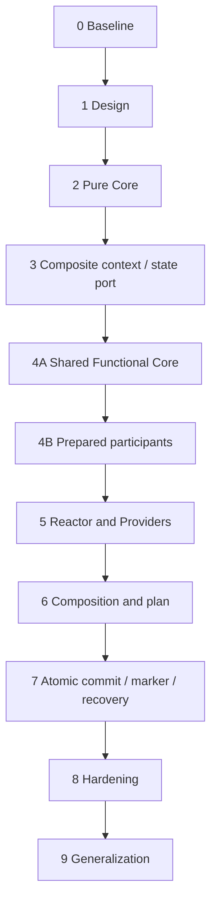

# Plano completo de implementação AMRI — roadmap e gates

O plano detalhado original permanece em [`../implementation-plan.md`](../implementation-plan.md). Este arquivo expande o plano em tarefas executáveis, subetapas e regras de entrada/saída. Cada fase deve gerar um commit/push verificável na mesma branch, após revisão.

## Visão geral

| Fase | Descrição | Estado em 2026-11-03 |
|---|---|---|
| 0 | Baseline e proteção | Concluída anteriormente |
| 1 | ADR/protocolo/documentação | Concluída como design; ADR-0034 Proposed |
| 2 | Core AMRI puro | Implementada/verificada anteriormente |
| 3 | Context planner + atomic state port | Implementada/verificada anteriormente |
| 4A | Shared Functional Core | Implementada, verificada pelo mantenedor, publicada |
| 4B | Prepared participants RFQ | Implementada e publicada (`5d278958855e41277bd00573d2cf419a50ee875d`); evidência local de gates ainda precisa ser registrada |
| 5 | Reactor + Providers | Pendente |
| 6 | Composition policies + commit plan | Pendente |
| 7 | Atomic FACTSTR commit, marker e recovery | Pendente |
| 8 | Hardening/performance/observabilidade | Pendente |
| 9 | Segundo domínio/generalização | Pendente |

## Regra de ciclo de vida de cada fase

1. Confirmar estado da janela de contexto de forma qualitativa, sem inventar percentual.
2. Ler `current-state.md`, o arquivo da fase e o código real na branch remota/local.
3. Confirmar branch, HEAD, origin e working tree limpo.
4. Fazer análise de impacto e allowlist de arquivos antes de gerar patch.
5. Criar scripts idempotentes e fail-closed; padrão `--dry-run`.
6. Testar scripts/transformações em fixtures isoladas.
7. Revisar diff completo e hashes.
8. Aplicar com backup e rollback.
9. Rodar gates específicos, preservando a distinção entre testes executados e pulados.
10. Revisar diff/status e criar commit separado.
11. Push fast-forward sem force; verificar o HEAD remoto.
12. Atualizar logs/documentos e só então abrir próxima fase.

## Fases individuais

Ver `stages/` para os detalhes executáveis: `stage-00` a `stage-09`, com Stage 4 dividida em `stage-04a` e `stage-04b`.

## Ordem obrigatória de dependências

## Regras de não antecipação

- Stage 4B não implementa Reactor nem chama ports.
- Stage 5 não implementa composição de regras de negócio que pertence à Stage 6.
- Stage 6 não grava no storage nem implementa marker/recovery.
- Stage 7 é o primeiro estágio de integração AMRI com commit real, um único `append_if` no adapter.
- Stage 8 não altera semântica de negócio para acomodar benchmarks; registra limites/telemetria/recovery.
- Stage 9 prova reuse com outro domínio antes de considerar extração em crate.

## Critério de conclusão global da ADR-0034

A ADR só pode mudar de `Proposed` para `Accepted` quando todos os critérios finais do ADR-0034 forem demonstrados: contracts/ownership revisados; snapshot/token comprovados; cenário de três participantes atômico; marker e recovery; testes existentes verdes; boundary guards; segundo domínio; documentação alinhada. Stage 4A/4B concluídas não aceitam AMRI completo.
