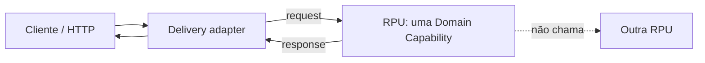
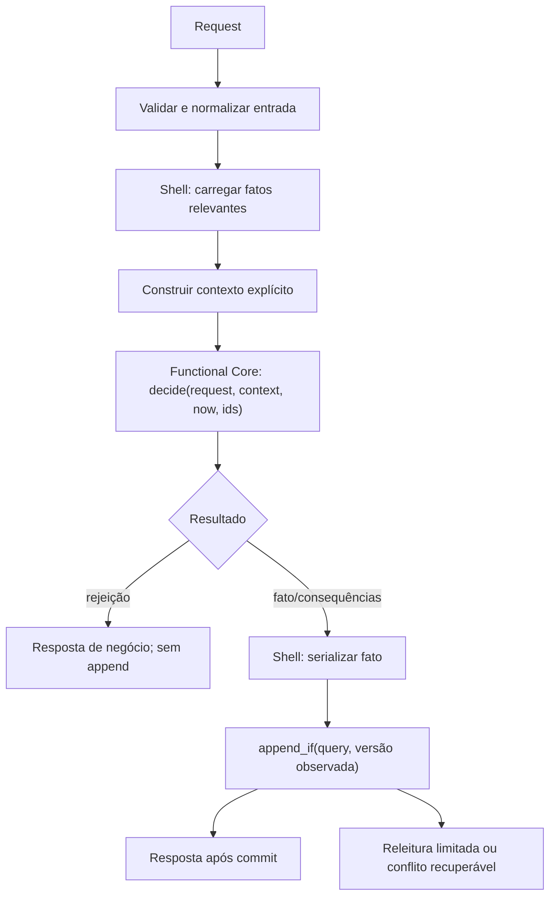
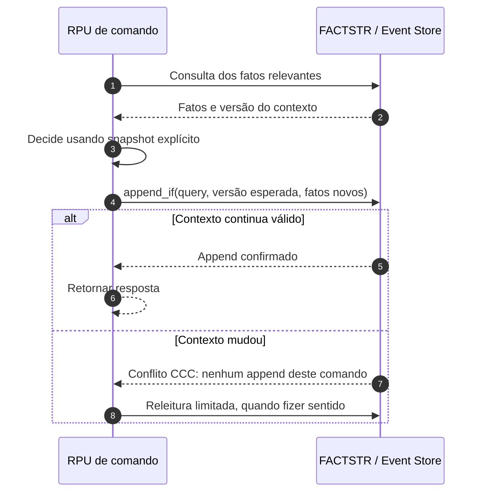
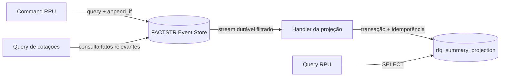

# Guia de design: Domain Capabilities, RPU, Functional Core, CCC e FACTSTR

> Este documento descreve a intenção arquitetural da branch `event-sourcing-factstr`. É um guia de implementação e revisão, não uma declaração de prontidão para produção.

## 1. A unidade arquitetural é a capability

Uma **Domain Capability** é uma ação ou pergunta que faz sentido no domínio, como `SubmitSupplierQuote` ou `ListSupplierQuotes`. A implementação de uma capability fica em uma **Request Processing Unit (RPU)** independente.

O contrato público de uma RPU deve ser pequeno: `process(request) -> response`. Quem chama a RPU não precisa conhecer seu contexto interno, seus helpers, a estrutura de decisão ou a tecnologia de persistência. O handler HTTP converte DTOs de transporte para requests e converte responses em DTOs externos.

## 2. Estrutura interna: Functional Core / Imperative Shell

A RPU completa não é pura. A shell concentra os efeitos; o núcleo funcional toma uma decisão determinística com valores explícitos.

Boas práticas:

- A decisão pura não lê relógio, banco, rede ou variáveis globais; valores não determinísticos entram como parâmetros.
- `load_context` consulta o Application State; `build_context` transforma fatos em um contexto mínimo, tipado e explícito.
- `decision`/`generate_consequences` aplica regras de negócio sem I/O.
- `append_consequences` grava as consequências contra o contexto que sustentou a decisão.
- Testes unitários verificam a regra pura; testes de integração verificam a shell com o Event Store real.

## 3. Command Context Consistency (CCC)

A CCC protege **os fatos em que a decisão realmente se baseia**, e não um agregado ou uma entidade escolhida antecipadamente.

A query é uma parte da regra de negócio:

- O `EventQuery` combina os filtros por `OR`. Dentro de cada `EventFilter`, os valores de `event_types` são alternativas (`OR`), assim como os valores de `payload_predicates` (`OR`). A condição de tipo e a condição de payload precisam ambas corresponder ao evento (`AND` entre esses dois resultados).
- Um contexto excessivamente amplo gera conflitos falsos e reduz concorrência lógica.
- Um contexto estreito demais pode permitir que uma decisão seja confirmada após um fato relevante ter mudado.
- Toda alteração das regras da decisão deve provocar uma revisão da query de contexto e um teste de contexto obsoleto.

### Contextos desta implementação

| Capability | Fatos relevantes para CCC | Invariante protegida |
|---|---|---|
| `OpenRfq` | Aberturas com o `rfq_id` solicitado ou a referência normalizada | Identidade e referência de RFQ únicas |
| `RegisterSupplier` | Registros com o `supplier_id` ou referência natural solicitados | Identidade e referência de fornecedor únicas |
| `SetSupplierEligibility` | Registro do fornecedor solicitado | O fornecedor precisa existir antes da atribuição de elegibilidade |
| `SubmitSupplierQuote` | Abertura/fechamento da RFQ; registro/elegibilidade do fornecedor; cotação prévia do mesmo par RFQ-fornecedor | RFQ aberta, fornecedor elegível e no máximo uma cotação por fornecedor/RFQ |
| `CloseRfq` | Abertura e fechamento da mesma RFQ | Somente RFQ existente e ainda aberta pode ser fechada |

**Semântica de `SetSupplierEligibility`:** esta variante trata o comando como atribuição de estado (`set`), não como transição condicionada ao valor anterior. Por isso, o histórico de elegibilidade não faz parte da query de consistência dessa decisão. Duas atribuições concorrentes podem ambas ser registradas; o fato confirmado por último determina o status corrente. Essa escolha é intencional nesta implementação de referência e deve ser alterada junto com a regra e os testes se o domínio exigir transições com pré-condições sobre o status anterior.

`SubmitSupplierQuote` possui semântica diferente: o status de elegibilidade atual é parte da decisão de cotação. Portanto, a query dessa RPU precisa incluir o histórico de elegibilidade daquele fornecedor, e uma mudança para `Blocked` deve invalidar uma cotação preparada contra um contexto anterior.

## 4. Fact-first Event Sourcing e read models

FACTSTR é o registro autoritativo append-only. Uma projeção é uma leitura derivada para responder perguntas sem reconstruir todo o histórico em cada consulta.

Invariantes operacionais da projeção atual:

1. O Event Store permanece a fonte de verdade; o read model pode ser reconstruído.
2. A projeção grava um lote numa transação e só retorna sucesso ao consumidor depois do commit.
3. A sequência aplicada evita contagem duplicada quando o mesmo lote é reentregue.
4. O cursor durável avança após o handler concluir com sucesso.
5. As consultas de resumo são eventualmente consistentes; um comando pode ser confirmado antes de o read model refletir o fato.

Evite transformar a projeção em uma segunda fonte de verdade: nenhuma decisão de comando deve depender do `status` ou dos contadores da projeção.

## 5. Evoluir uma capability com segurança

Ao adicionar ou mudar uma regra, use esta revisão como checklist:

1. Nomeie a intenção como um comando ou uma query, não como uma operação CRUD genérica.
2. Descreva a regra em linguagem de domínio e os resultados/rejeições possíveis.
3. Identifique exatamente os fatos que justificam a decisão.
4. Atualize o construtor de contexto e a query CCC em conjunto.
5. Mantenha o núcleo puro; passe instante, IDs e outros valores não determinísticos como argumentos.
6. Versione novos contratos de fatos; não reescreva fatos já persistidos.
7. Teste o núcleo puro, o caminho de sucesso/rejeição, a mudança de contexto entre leitura e escrita, duplicidade e ausência de conflito semântico entre contextos independentes.
8. Para read models, teste replay, lote parcialmente inválido, reentrega idempotente e retomada após falha.
9. Revise o contrato de response da RPU e o contrato HTTP sem expor tipos internos ou payloads de eventos por acidente.
10. Atualize este guia, o README, os diagramas e os exemplos de API quando a semântica mudar.

## 6. Decisões e limites conhecidos

- O projeto é um exemplo de arquitetura, não um produto procurement pronto para produção.
- Não são demonstradas ainda autenticação/autorização, idempotência HTTP, alto volume, anexos, impostos, aprovação, seleção multicritério ou observabilidade operacional completa.
- O backend PostgreSQL do FACTSTR deve ser avaliado por benchmarks de throughput e latência para a carga-alvo. Independência lógica de contextos não implica gravações fisicamente paralelas.
- A estratégia de reconstrução de projeções precisa de um procedimento operacional versionado e seguro; não dependa de apagar manualmente tabelas internas do Event Store como procedimento normal.

## 7. Providers e estabilidade durante retries

`ClockProvider` e `IdProvider` encapsulam os efeitos de relógio e geração de IDs na Imperative Shell. As funções puras recebem instantes e IDs como valores; não recebem Providers. Os handlers de produção obtêm as dependências da composição da aplicação.

Para `SubmitSupplierQuote`, o ID e o horário de submissão são capturados uma vez por execução lógica e reutilizados após conflito CCC. O horário de submissão é distinto de qualquer futuro instante de aceitação. Caso o domínio exija validade no instante da aceitação, a decisão deverá receber ambos os instantes com semântica explícita.

Veja o [catálogo de ADRs](architecture/adr/README.md), especialmente ADR-0010 e ADR-0011.

## 8. Referências primárias

- [Architecture Knowledge Base — conceitos](https://architecture.ricofritzsche.me/concepts/)
- [Request Processing Units](https://architecture.ricofritzsche.me/concepts/request-processing-units/)
- [Command Context Consistency](https://architecture.ricofritzsche.me/concepts/command-context-consistency/)
- [Functional Core / Imperative Shell](https://architecture.ricofritzsche.me/concepts/functional-core-imperative-shell/)
- [FACTSTR](https://github.com/ricofritzsche/factstr)
- [FACTSTR Tool Rental Example — Rust](https://github.com/ricofritzsche/factstr-tool-rental-example/tree/main/rust)
- [Functional Event Sourcing in Rust](https://github.com/ricofritzsche/fcis-event-sourcing-rust)
