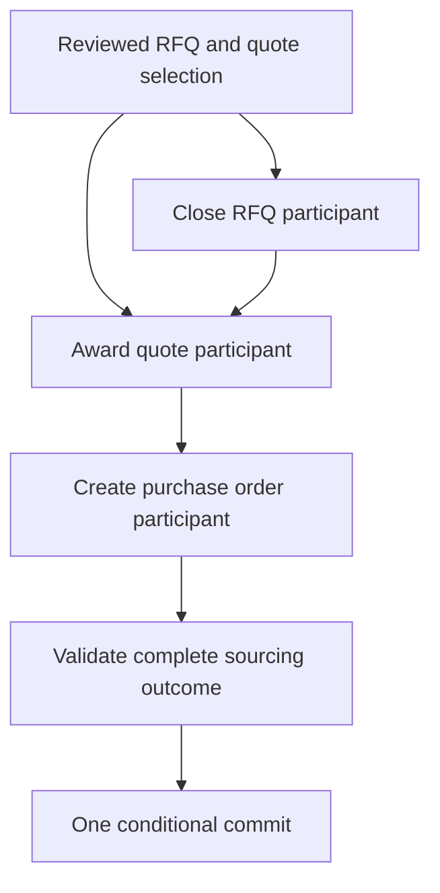

# AMRI reference interaction — atomic RFQ sourcing finalization

**Status:** Proposed target scenario; not implemented.

**Baseline:** `FinalizeRfqSourcing` in ADR-0031 remains the implemented single-capability solution.

## 1. Purpose

Demonstrate a bounded interaction in which at least three independent Supply Chain capabilities each validate their own responsibilities and propose facts. An Atomic Interaction Reactor coordinates them, validates the full composition and requests one conditional batch commit.

The scenario must prove a materially different capability structure from the existing `FinalizeRfqSourcing` RPU. It is not a rename or a wrapper around that existing operation.

## 2. Participants

| Participant | Capability responsibility | Proposed fact |
|---|---|---|
| `CloseRfqParticipant` | Verify RFQ lifecycle and prepare closure | `rfq_closed.v1` |
| `AwardSupplierQuoteParticipant` | Verify reviewed quote, supplier registration/eligibility and award rules | `rfq_awarded.v1` |
| `CreatePurchaseOrderParticipant` | Verify commercial consistency and prepare PO | `purchase_order_created.v1` |
| Optional `RequestPurchaseOrderDispatchParticipant` | Prepare durable external dispatch intent | `purchase_order_dispatch_requested.v1` |

Each participant must reuse its capability's Functional Core. `CloseRfqParticipant` may reuse the rules currently in `CloseRfq`; award and PO participants may require extraction of pure rules from `FinalizeRfqSourcing` or new capability-specific rules. This must be demonstrated with parity tests before production code is moved.

The first acceptance scenario uses the first three participants. The dispatch intent can be a fourth participant if it has a genuinely independent capability responsibility; otherwise it remains a consequence owned by the PO or sourcing capability. Do not create a participant solely to reach a participant count.

## 3. Dependencies

The dependency from close to award represents the declared interaction protocol, not a direct call/import between capabilities. Award receives the prepared closure outcome as immutable data. PO receives the prepared award outcome. All three participants use typed projections of the same authoritative snapshot.

The domain owner must review whether Award actually depends on the proposed Close result. If not, the edge should be removed; the graph must reflect real business dependencies, not an arbitrary sequence.

## 4. Composite context

At minimum, the union of the participants' read sets must protect:

- RFQ opening and closing lifecycle;
- the full quote set that the buyer reviewed;
- selected quote and its RFQ/supplier identity;
- supplier registration and relevant eligibility history;
- prior award and purchase-order facts;
- prior interaction marker for the same InteractionId;
- any additional facts required by PO rules or cross-capability policies.

The quote-set revision supplied by the user/UI is a domain review token and is distinct from the adapter's composite consistency token. Both must be checked. The AMRI consistency token protects changes after the single snapshot; the buyer's review token protects against a selection that was already stale before the interaction began.

## 5. External Providers in the reference scenario

Use fake, read-only providers first:

- ERP reference provider: checks supplier/product mapping and returns source revision/reference.
- Tax/compliance provider: returns classification or compliance evidence with checked time and expiry.

These results are evidence used by domain-owned composition policy. They do not reserve inventory, create a purchase order in an ERP, or freeze the external state. A future reservation-capable ERP provider must specify lease/fencing and release behavior.

The actual ERP dispatch occurs after the AMRI batch commits, driven by `purchase_order_dispatch_requested.v1` or an equivalent durable intent. Downstream retry and reconciliation are outside the atomic FACTSTR commit.

## 6. Expected atomic batch

The reference batch contains:

1. `rfq_closed.v1`;
2. `rfq_awarded.v1`;
3. `purchase_order_created.v1`;
4. optionally `purchase_order_dispatch_requested.v1` if owned by a separate participant or explicitly part of the same domain decision;
5. proposed technical marker `amri_interaction_committed.v1`.

All members are submitted in one FACTSTR `append_if` against the same composite query/token. No participant uses `append` or `append_if`.

The event order must be deterministic and versioned with the interaction definition. Domain projections must explicitly ignore the AMRI marker unless they have a reason to consume it.

## 7. Required scenarios

- All three participants prepare successfully: one batch is committed.
- Each participant independently rejects: zero facts from the interaction.
- Award references a different RFQ/supplier/quote: composition rejects, zero facts.
- PO terms differ from the awarded quote: composition rejects, zero facts.
- Provider unavailable or evidence expired: zero facts unless a documented policy permits omission.
- A relevant quote, eligibility, closure, award or PO fact changes after snapshot: CCC conflict, zero facts.
- An irrelevant fact outside the composite read set does not cause a logical conflict where the backend contract permits that distinction.
- An autonomous legacy RPU races with AMRI and changes a protected fact: one operation loses according to the conditional boundary; never partial facts.
- Two AMRI interactions use the same InteractionId and fingerprint: one batch only; the other resolves as already committed/conflict and recovers the receipt.
- Same InteractionId with a different fingerprint: rejection, no second batch.
- Commit succeeds but response is lost: retry recognizes the marker and reconstructs the result without re-appending.

## 8. Comparison with the existing implementation

`FinalizeRfqSourcing` is the simpler and valid solution when closure, award, PO creation and dispatch intent form one domain capability with one decision core. AMRI is justified only if the requirements establish independently owned capabilities with reusable local decisions and a need to compose their consequences atomically.

The acceptance tests must compare behavior for equivalent business scenarios and show that the AMRI path adds no regression in event contracts, eligibility rules, quote validity, money arithmetic or response semantics. This is a new reference flow, not a replacement of ADR-0031 during the proposal stage.
