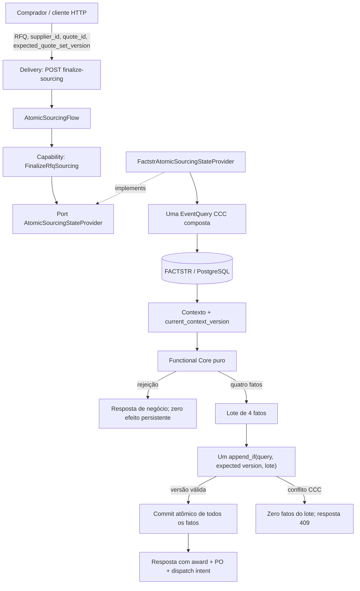
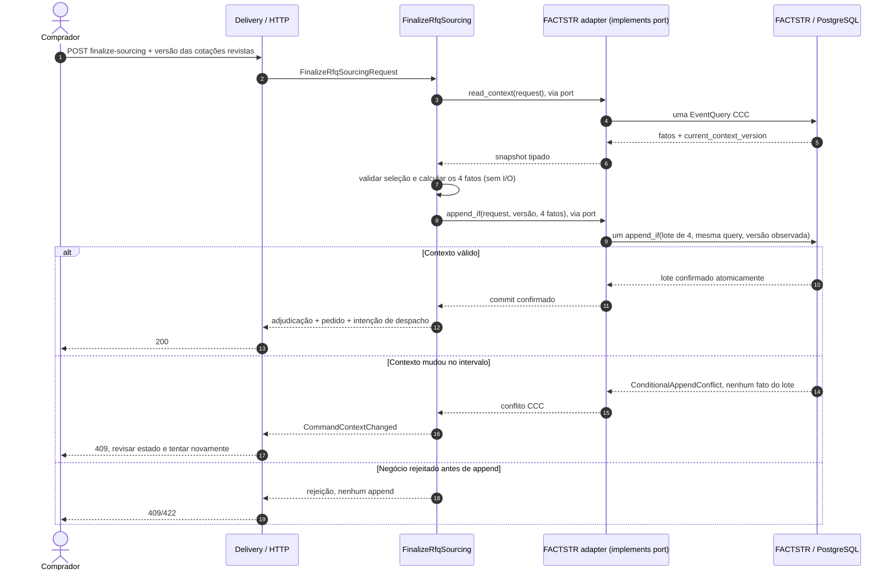

# Novo fluxo de negócio: finalização atômica do sourcing de uma RFQ

**Status:** implementado na branch `main`; capability aditiva, com RPU e testes de Functional Core/aceitação PostgreSQL.

**Capability:** `FinalizeRfqSourcing`.
**Fonte autoritativa:** FACTSTR 0.5.2 / PostgreSQL.  
**Regra de consistência:** um único `append_if` contendo o lote completo.

## Classificação arquitetural

`FinalizeRfqSourcing` é uma única Domain Capability/RPU. O fato de uma decisão gerar quatro fatos não a transforma em um Reactor: não há coordenação de múltiplas RPUs ou operações externas. A RPU mantém a decisão no Functional Core e a leitura/única gravação condicional na Imperative Shell. `AtomicSourcingFlow` é apenas uma fachada pass-through da composição atual e não implementa as responsabilidades de um Reactor; seu nome é ambíguo e sua remoção é uma limpeza futura, fora do escopo desta documentação. Consulte [ADR-0031](../architecture/adr/0031-atomic-rfq-sourcing-finalization.md) e [ADR-0033](../architecture/adr/0033-application-state-provider-specialized-ports.md).

## 1. Objetivo de negócio

Depois de analisar as cotações de uma RFQ, o comprador seleciona explicitamente uma cotação/fornecedor e confirma o sourcing. Essa única decisão de negócio precisa:

1. fechar a RFQ;
2. registrar a adjudicação ao fornecedor e à cotação escolhidos;
3. registrar o pedido de compra no domínio;
4. registrar uma intenção durável de encaminhar o pedido ao ERP ou sistema externo.

Ou todos esses quatro fatos são confirmados juntos, ou nenhum deles é confirmado. Este fluxo não tenta desfazer ações anteriores por compensação.

A escolha de fornecedor é explicitamente humana. A primeira versão não implementa ranqueamento automático, avaliação de impostos/frete/custo posto, workflow de aprovação, adjudicação parcial ou múltiplos fornecedores.

## 2. Invariantes

- Uma RFQ existente, ainda aberta, é pré-requisito.
- O fornecedor selecionado precisa estar registrado e ter sua elegibilidade atual definida como `eligible`.
- A cotação selecionada precisa pertencer à RFQ e ao fornecedor selecionado, ainda estar válida, usar a moeda da RFQ e corresponder exatamente ao conjunto de itens/quantidades solicitados.
- A aritmética de valores monetários usa centavos inteiros e operações `checked_*`; não usa ponto flutuante.
- O cliente envia `expected_quote_set_version`: maior `sequence_number` entre as cotações que o comprador efetivamente reviu. Se o conjunto mudou antes da leitura, o comando é rejeitado para revisão humana; não há retry silencioso.
- A consulta CCC inclui todos os fatos que podem invalidar a decisão. Se qualquer fato relevante mudar depois da leitura, `append_if` rejeita a operação inteira.
- O lote inclui `rfq_closed.v1`, `rfq_awarded.v1`, `purchase_order_created.v1` e `purchase_order_dispatch_requested.v1`.
- O fluxo não chama `CommandRpus` nem funções/shells das capabilities existentes. As RPUs legadas continuam imutáveis e atendendo seus contratos individuais.

## 3. Arquitetura: caminho novo separado



A capacidade nova define o port `AtomicSourcingStateProvider` e usa o adapter `FactstrAtomicSourcingStateProvider`. Ela não amplia `ApplicationStateProvider` nem altera `FactstrApplicationStateProvider`, pois essas portas são o contrato dos fluxos legados. Isso é uma separação intencional, não duplicação acidental: os comandos antigos mantêm o commit individual; o comando composto usa uma fronteira transacional de negócio diferente.

## 4. Sequência e concorrência



### Interleavings que devem funcionar

- **Outra cotação chega antes da query:** seu `sequence_number` é maior que o token enviado; `QuoteSetChanged`, sem gravação. O comprador precisa rever a nova cotação.
- **Outra cotação chega depois da query e antes do `append_if`:** a versão CCC muda; o append condicional falha e nenhum dos quatro fatos é gravado.
- **Uma RPU legada fecha a RFQ primeiro:** o contexto de ciclo de vida muda e a finalização falha por CCC; nenhuma adjudicação/pedido é persistido.
- **A finalização confirma primeiro:** o evento `rfq_closed.v1` faz uma submissão de cotação concorrente que use seu CCC atual falhar ou ser rejeitada após releitura. O teste de integração verifica esta direção explicitamente.
- **Duas finalizações são preparadas no mesmo snapshot:** só uma pode confirmar. O segundo append encontra conflito e não duplica o lote.
- **Fornecedor deixa de ser elegível depois da leitura:** a alteração de elegibilidade integra a query CCC. O lote não pode ser confirmado contra o estado antigo.

## 5. Escopo exato de consistência e semântica da query

A query composta cobre:

- abertura e fechamento da RFQ;
- todas as cotações submetidas para essa RFQ (não apenas a cotação escolhida), para proteger o conjunto que o comprador reviu;
- registro e histórico de elegibilidade do fornecedor escolhido;
- adjudicações, pedidos e intenções de despacho anteriores para a RFQ, impedindo repetição do comando.

FACTSTR 0.5.2 combina `EventFilter`s de uma `EventQuery` com OR. Dentro de cada filtro, tipos de evento e predicados do payload têm semântica OR entre seus valores, enquanto o match do tipo e o do payload precisam ocorrer juntos. Cada filtro aqui especifica um tipo de evento e um identificador de RFQ ou fornecedor.

A `current_context_version` da query inteira é o token passado a `append_if`; não deve ser substituída pela maior sequência retornada apenas por um cursor/segmento. Já `expected_quote_set_version` é um token de negócio da UI, derivado da maior sequência de cotações exposta na leitura de cotações, para detectar que o comprador não viu uma cotação nova. São dois tokens diferentes e ambos são necessários:

- versão do conjunto de cotações: confirma que a decisão humana usa a lista revista;
- versão CCC da query composta: detecta quaisquer alterações concorrentes entre leitura e commit.

## 6. Fatos e batch

| Tipo | Intenção | Persistência |
|---|---|---|
| `rfq_closed.v1` | fechar a RFQ | mesmo lote |
| `rfq_awarded.v1` | registrar qual cotação/fornecedor foi escolhido | mesmo lote |
| `purchase_order_created.v1` | registrar o pedido de compra no domínio | mesmo lote |
| `purchase_order_dispatch_requested.v1` | registrar intenção durável de despacho externo | mesmo lote |

O nome `purchase_order_dispatch_requested.v1` é intencional: o fato **não** afirma que o ERP externo aceitou/criou o pedido. Ele afirma apenas que a intenção foi confirmada no domínio. Uma entrega real ao ERP precisa de um consumidor/despachante posterior, retry com backoff, idempotency key estável (por exemplo `dispatch_id`), observabilidade, reconciliação e política de dead-letter. Essa integração não pode ser descrita como atômica com FACTSTR sem um protocolo compartilhado suportado pelo ERP.

A projeção existente de resumo de RFQ continuará ignorando tipos de fatos que não fazem parte de seu modelo atual. A projeção não é fonte de verdade.

## 7. Por que não reutilizar as shells antigas

`OpenRfq`, `RegisterSupplier`, `SetSupplierEligibility`, `SubmitSupplierQuote` e `CloseRfq` chamam sua própria shell e cada uma pode confirmar seu próprio append CCC. Encadear essas operações criaria a sequência parcial que o requisito proíbe. Preparar três RPUs separadamente também não é suficiente se cada `prepare` tiver efeitos ou se houver três commits subsequentes.

Nesta implementação, as regras necessárias à finalização são avaliadas em um núcleo funcional novo, usando fatos já registrados como dados. A persistência apenas acontece no único `append_if`. A funcionalidade e os contratos das RPUs legadas não são alterados.

## 8. Contrato HTTP implementado

`POST /api/rfqs/{rfq_id}/finalize-sourcing` (idempotency middleware existente)

```json
{
  "supplier_id": "UUID do fornecedor escolhido",
  "quote_id": "UUID da cotação que o comprador reviu",
  "expected_quote_set_version": 123
}
```

`expected_quote_set_version` é um inteiro `u64` com o `sequence_number` máximo no conjunto de cotações apresentado ao comprador. A versão real de produção deve garantir que cliente/servidor usam a mesma definição para filtros, paginação e visibilidade de cotações; a versão derivada de uma página parcial não é válida se a UI seleciona sobre o conjunto completo.

A resposta tem quatro objetos: `closed`, `awarded`, `purchase_order`, `dispatch_requested`. O 409 `quote_set_changed` exige reload/revisão; o 409 `command_context_changed` indica conflito de concorrência no intervalo entre query e commit. Não automatizar reenvio com uma nova seleção sem consentimento/revisão humana.

## 9. Testes obrigatórios

### Functional Core

- caminho válido produz exatamente quatro consequências consistentes;
- RFQ ausente/fechada/já finalizada;
- fornecedor ausente/sem elegibilidade/bloqueado;
- token de cotação obsoleto;
- cotação ausente, IDs incompatíveis ou duplicada;
- cotação expirada, moeda incorreta, prazo de entrega inválido, itens faltantes/extras/duplicados;
- quantidades/preços/totais inválidos e overflow multiplicação/soma;
- ausência de I/O e determinismo com clock/IDs explícitos.

### FACTSTR/PostgreSQL real com Testcontainers

- sucesso grava os quatro tipos de fato numa única batch;
- qualquer rejeição pré-commit deixa zero fatos de finalização;
- concorrência depois da preparação causa `ConditionalAppendConflict` e deixa zero dos quatro fatos;
- duas preparações sobre o mesmo contexto: somente a primeira confirmação grava os quatro fatos;
- mudança concorrente de elegibilidade e mudança concorrente de conjunto de cotações;
- submissão de cotação vs fechamento/finalização em ambos os ordenamentos;
- projeção antiga continua consistente e ignora os tipos novos sem falhar;
- replay/idempotência HTTP e resposta ambígua depois de commit são avaliadas separadamente, sem alegar que o ledger HTTP e FACTSTR fazem dual-write atômico.

### Gates existentes

Preservar a suíte antiga. Executar em checkout local: `cargo fmt --check`, `cargo check --all-targets --all-features --locked`, `cargo clippy --all-targets --all-features --locked -- -D warnings`, `cargo test --all-features --locked`, `bash scripts/verify-rpu-boundaries.sh`, `bash scripts/verify-openapi.sh`, `sh scripts/verify-mermaid-diagrams.sh`, `bash scripts/verify-documentation-current-state.sh` e `bash scripts/coverage-functional-core.sh`. Testcontainers exige Docker. O checker de cobertura funcional deve incluir `src/capabilities/finalize_rfq_sourcing/decision.rs` e manter 100% de ramos nos arquivos definidos.

## 10. Fora do escopo / riscos residuais

- Envio real do pedido a ERP/broker: somente intenção event-sourced está neste fluxo; dispatcher downstream requer trabalho separado.
- Atomicidade entre FACTSTR e ledger HTTP `Idempotency-Key`: não é garantida por este desenho. A guarda de RFQ finalizada impede criar um segundo award/PO, mas a recuperação da resposta após timeout ainda precisa de um contrato de reconciliação/deduplicação explícito.
- Fluxo longo com aprovação humana externa, cálculo tributário, autorização de gasto ou fontes remotas: chamar essas dependências antes do commit pode aumentar o tempo entre query e append; preferir gerar propostas fora do comando e validar os fatos decisivos novamente no único CCC.
- Alto volume: FACTSTR/PostgreSQL 0.5.2 usa serialização no caminho de append do backend; medir contenção e latência antes de prometer throughput.
- O repositório segue sendo referência educacional; segurança, SLOs, recuperação operacional e benchmarks não são resolvidos por esta mudança.

## Referências

- [ADR-0031 — Atomic RFQ sourcing finalization](../architecture/adr/0031-atomic-rfq-sourcing-finalization.md)
- [RPU](https://architecture.ricofritzsche.me/concepts/request-processing-units/)
- [Functional Core / Imperative Shell](https://architecture.ricofritzsche.me/concepts/functional-core-imperative-shell/)
- [Command Context Consistency](https://architecture.ricofritzsche.me/concepts/command-context-consistency/)
- [FACTSTR event store API/specification](https://architecture.ricofritzsche.me/specifications/command-context-consistency/event-store-api/)
